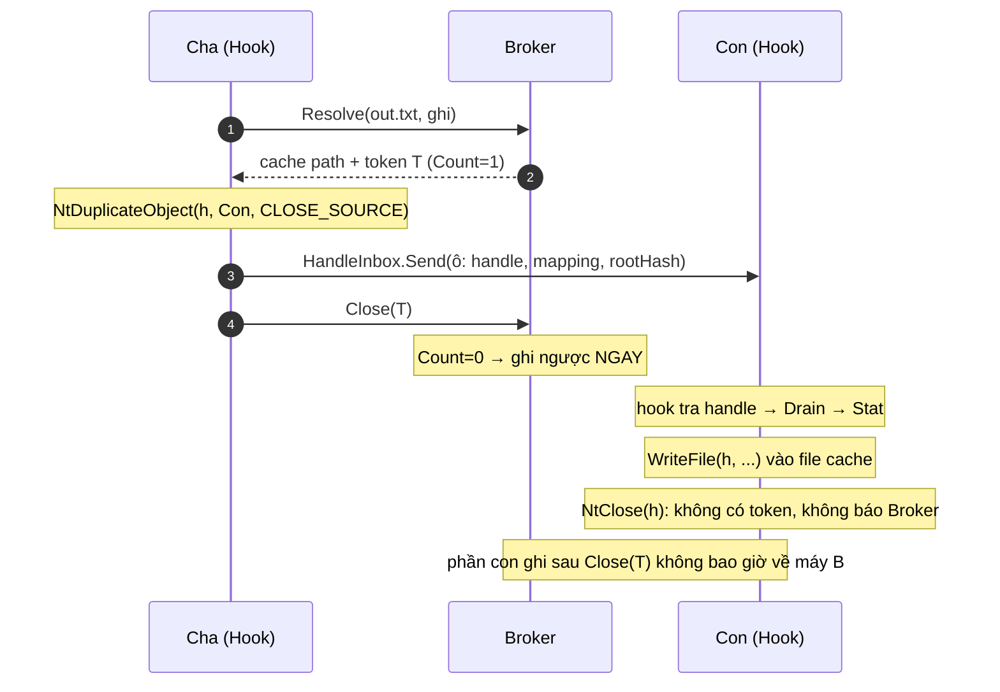
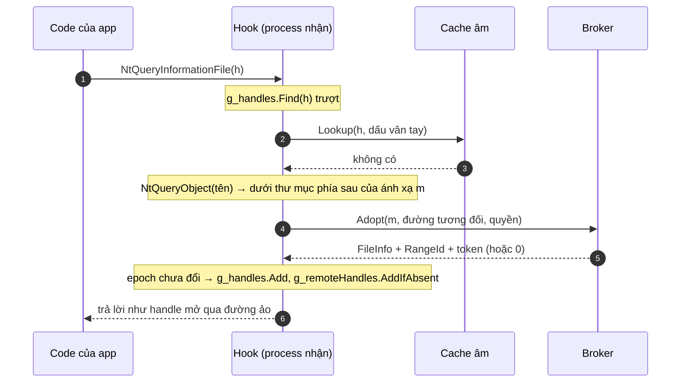
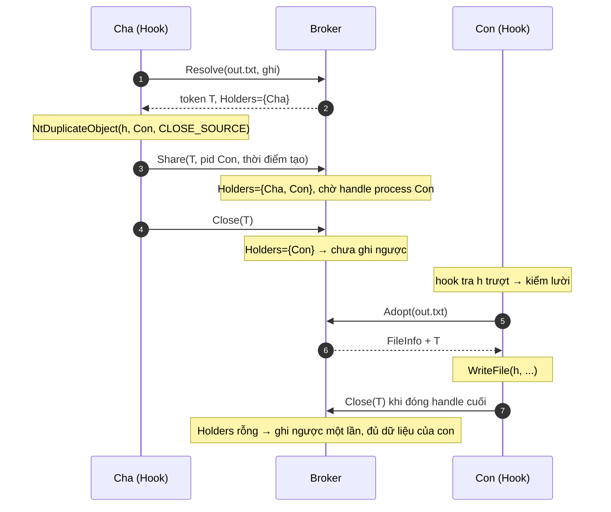
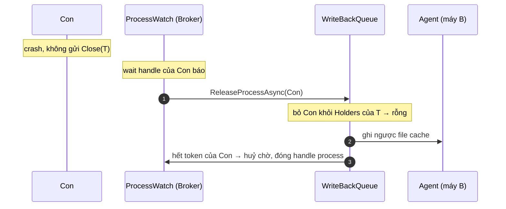

# Thiết kế: chia sẻ handle ảo giữa các process và đếm write token theo process

Trạng thái: **xong** (2026-11-27). Bước 1-5 ở nhánh `feature/handle-sharing` (lệch nhỏ: chiều kế thừa gửi `Share` ngay ở
bước 4); bước 6-8 ở nhánh `feature/handle-lazy-adopt`, các chỗ lệch so với thiết kế ghi ở [mục 12](#12-kết-quả-bước-6-8).

Gom hai mục backlog vào một thiết kế vì chúng chạm cùng một chỗ (handle ảo đi sang process khác):

- `[Cao] Write token ở lại bên gửi khi nhân bản handle ghi sang process khác` (đã sửa ở bước 1-5, mục backlog đã xoá).
- `[Vừa] Hộp thư handle chỉ được đọc ở hook tra handle; chiều kéo và handle kế thừa không được theo dõi` (đã sửa ở bước 6-7,
  mục backlog đã xoá).

Hướng user đã chọn:

1. Broker đếm tham chiếu write token **theo process** (không theo số lần `Close`); chỉ ghi ngược khi process giữ cuối cùng
   đóng handle hoặc thoát.
2. Bỏ hộp thư shared memory (`HandleInbox`); khi hook gặp handle lạ thì **kiểm lười** bằng `IsBackedByMapping` ([lazy adopt](Glossary-vi.md#L90), tên thật nằm
   dưới thư mục phía sau + `Stat`/hỏi Broker), kèm **cache âm** theo handle + thế hệ.

## Mục lục

1. [Mục tiêu và ngoài phạm vi](#1-mục-tiêu-và-ngoài-phạm-vi)
2. [Luồng hiện tại](#2-luồng-hiện-tại)
3. [Thiết kế mới: tổng quan](#3-thiết-kế-mới-tổng-quan)
4. [Kiểm lười handle lạ (lazy adopt)](#4-kiểm-lười-handle-lạ-lazy-adopt)
5. [Đếm write token theo process](#5-đếm-write-token-theo-process)
6. [Thay đổi Hook IPC (phiên bản 6)](#6-thay-đổi-hook-ipc-phiên-bản-6)
7. [Đồng thời và lỗi](#7-đồng-thời-và-lỗi)
8. [Chi phí hiệu năng](#8-chi-phí-hiệu-năng)
9. [Các bước chuyển đổi (thứ tự commit)](#9-các-bước-chuyển-đổi-thứ-tự-commit)
10. [Kế hoạch test](#10-kế-hoạch-test)
11. [Câu hỏi mở cho user](#11-câu-hỏi-mở-cho-user)
12. [Kết quả bước 6-8](#12-kết-quả-bước-6-8)

## 1. Mục tiêu và ngoài phạm vi

### Mục tiêu

- **Không mất dữ liệu** khi handle ghi đi sang process khác: cha nhân bản handle vào con rồi đóng bản của mình (kể cả
  `DUPLICATE_CLOSE_SOURCE`, chuyển hướng stdout của con vào file ảo), thứ con ghi sau đó vẫn được ghi ngược về máy B.
- Ghi ngược đúng **một lần ở cuối**: khi process cuối cùng còn giữ token đóng handle hoặc thoát, không sớm hơn.
- Process thoát mà không đóng handle (kể cả crash, kể cả con inject thất bại) thì phần giữ của nó được trả **lúc process
  thoát**, không đợi hết phiên (`SyncOpenAsync`).
- Bên nhận nhận ra handle ảo ở **mọi hướng**: nhân bản đẩy (bên gửi có hook), nhân bản kéo (bên nhận tự `DuplicateHandle`
  từ process khác về), kế thừa (`CreateProcess(bInheritHandles)`), handle do process không có hook đưa sang.
- Bỏ bề mặt tấn công và các giới hạn của hộp thư: 16 ô, ô kẹt, thời gian chờ thu hồi, tên bị chiếm trước, mục giả.

### Ngoài phạm vi

- Delete-on-close đi theo handle nhân bản (vẫn chỉ process mở gốc xoá máy B), ghi theo khối, hard link.
- Handle ảo truyền sang process **không có hook** vẫn chỉ được giữ token (để không ghi ngược sớm); process đó thấy tên
  thật của file cache như hôm nay.
- Gốc ảo trên ổ giả (`V:\`), luồng dữ liệu phụ: không đổi.
- Chế độ cục bộ (`PROCBRIDGE_MAP`, không có Broker): không có token; chỉ phần kiểm lười áp dụng.

## 2. Luồng hiện tại

### 2.1 Bảng handle trong Hook

| Thành phần | Vị trí | Vai trò |
|---|---|---|
| `g_handles` (`HandleTable`) | [FileHooks.cpp:49](../src/native/ProcBridge.Hook/src/FileHooks.cpp#L49), [HandleTable.h:10-47](../src/native/ProcBridge.Hook/src/HandleTable.h#L10-L47) | handle → chỉ số ánh xạ, mỗi mục một generation để `Remove(handle, generation)` không xoá nhầm mục mới |
| `g_remoteHandles` (`RemoteHandleTable`) | [FileHooks.cpp:51](../src/native/ProcBridge.Hook/src/FileHooks.cpp#L51), [RemoteHandles.h:33-126](../src/native/ProcBridge.Hook/src/RemoteHandles.h#L33-L126) | handle → đường ảo, metadata máy B, write token, delete-on-close; **đếm số handle giữ cùng token trong process** (`RetainToken`/`ReleaseToken`, [RemoteHandles.h:109-126](../src/native/ProcBridge.Hook/src/RemoteHandles.h#L109-L126)) |
| `g_inbox` (`HandleInbox`) | [FileHooks.cpp:54](../src/native/ProcBridge.Hook/src/FileHooks.cpp#L54), [HandleInbox.h](../src/native/ProcBridge.Hook/src/HandleInbox.h) | hộp thư shared memory 16 ô nhận handle process khác nhân bản vào |
| `IsBackedByMapping` | [FileHooks.cpp:97-123](../src/native/ProcBridge.Hook/src/FileHooks.cpp#L97-L123) | `GetFileType` + `NtQueryObject(ObjectNameInformation)`: tên thật nằm dưới `RealDevicePath` của ánh xạ thì là handle ảo |
| `AdoptIncomingHandles` | [FileHooks.cpp:129-169](../src/native/ProcBridge.Hook/src/FileHooks.cpp#L129-L169) | rút hộp thư ở đầu mọi hook tra handle (vd [FileHooks.cpp:449](../src/native/ProcBridge.Hook/src/FileHooks.cpp#L449)) |

### 2.2 Write token

- Broker cấp token khi `Resolve` một lần mở có thể đổi nội dung: `WriteBackQueue.Open`
  ([HookRequestHandler.cs:412](../src/client/ProcBridge.Broker/HookRequestHandler.cs#L412),
  [WriteBackQueue.cs:86-108](../src/client/ProcBridge.Broker/WriteBackQueue.cs#L86-L108)).
- Hook lưu token theo handle (`TrackRemoteHandle`, [FileHooks.cpp:744-762](../src/native/ProcBridge.Hook/src/FileHooks.cpp#L744-L762)).
  Nhân bản trong cùng process chia token (đếm trong `RemoteHandleTable`).
- Handle cuối của process giữ token đóng (`NtClose`, [FileHooks.cpp:1940-1970](../src/native/ProcBridge.Hook/src/FileHooks.cpp#L1940-L1970))
  thì Hook gửi `Close` (`CloseWrite`, [BrokerResolver.h:58](../src/native/ProcBridge.Hook/src/BrokerResolver.h#L58)).
- Broker: `TokenState.Count` đếm **số lần Close còn chờ** chứ không biết process nào
  ([WriteBackQueue.cs:609-615](../src/client/ProcBridge.Broker/WriteBackQueue.cs#L609-L615)); `CloseAsync` giảm đếm, lần
  cuối của đường dẫn (`OpenCount == 1`) thì ghi ngược ([WriteBackQueue.cs:132-162](../src/client/ProcBridge.Broker/WriteBackQueue.cs#L132-L162)).
- Kế thừa: token đi trong khối khởi tạo của con (`InheritedRemoteRecord`, [FileHooks.cpp:2618-2627](../src/native/ProcBridge.Hook/src/FileHooks.cpp#L2618-L2627)),
  cha gửi `Retain` mỗi token một lần (`RetainForChild`, [FileHooks.cpp:2702-2729](../src/native/ProcBridge.Hook/src/FileHooks.cpp#L2702-L2729))
  → Broker `Count++` ([HookRequestHandler.cs:257-263](../src/client/ProcBridge.Broker/HookRequestHandler.cs#L257-L263),
  [WriteBackQueue.cs:114-124](../src/client/ProcBridge.Broker/WriteBackQueue.cs#L114-L124)). Con chết trước khi nhận khối
  khởi tạo thì phần `Count` của nó không bao giờ được trả.
- `RemoteHolds` (giữ share mode trên máy B) đã theo **process** (`Holders` là danh sách `clientId` = pid lấy từ
  `GetNamedPipeClientProcessId`, [HookIpcServer.cs:153-164](../src/client/ProcBridge.Broker/HookIpcServer.cs#L153-L164)) và
  trả khi kết nối pipe cuối của process đóng ([RemoteHolds.cs:159-183](../src/client/ProcBridge.Broker/RemoteHolds.cs#L159-L183)).
  `WriteBackQueue` thì không có gì tương tự.

### 2.3 Nhân bản sang process khác

`HookNtDuplicateObject` ([FileHooks.cpp:2358-2438](../src/native/ProcBridge.Hook/src/FileHooks.cpp#L2358-L2438)):

1. Tra `g_handles`/`g_remoteHandles` của handle nguồn (chỉ khi nguồn là chính process).
2. Gọi hàm gốc; `DUPLICATE_CLOSE_SOURCE` thì gỡ mục nguồn và lấy token ra (`closedSource`).
3. Đích là process khác: `SendDuplicate` ghi một ô vào hộp thư của đích
   ([FileHooks.cpp:2343-2353](../src/native/ProcBridge.Hook/src/FileHooks.cpp#L2343-L2353)); token **không** đi theo.
4. `closedSource.WriteToken != 0` thì `CloseWrite` ngay ([FileHooks.cpp:2428-2432](../src/native/ProcBridge.Hook/src/FileHooks.cpp#L2428-L2432)).

Bên nhận rút hộp thư ở hook tra handle kế tiếp, kiểm bằng `IsBackedByMapping`, lấy metadata bằng `Stat`, ghi vào bảng
không có token.



## 3. Thiết kế mới: tổng quan

Hai thay đổi độc lập về code nhưng phải lên cùng một phiên bản Hook IPC:

| Phần | Trước | Sau |
|---|---|---|
| Nhận diện handle ảo đến từ process khác | Hộp thư shared memory, bên gửi phải có hook | Kiểm lười ở bên nhận khi gặp handle lạ + cache âm |
| Metadata của handle nhận | `Stat` theo đường suy từ tên | `Adopt` (mới): metadata + range id + token (nếu process này được chia) |
| Write token qua process | Ở lại bên gửi | Broker giữ **tập process giữ** của mỗi token |
| Process thoát không đóng | Trả lúc hết phiên | Broker chờ handle process, trả lúc process thoát |
| Kế thừa | `Retain(token)` tăng đếm | `Share(token, pid con, thời điểm tạo)` thêm process giữ |

Broker **hôm nay không biết cây process**: Job Object nằm trong `ProcBridge.Spawn`
([main.cpp:232-234](../src/native/ProcBridge.Spawn/src/main.cpp#L232-L234)), Broker chỉ biết pid của từng kết nối pipe. Thiết kế
không cần cây: bên gửi báo thẳng pid đích (process đích chắc chắn nhận được handle), Broker tự mở handle process đích để biết
lúc nó thoát. Xem câu hỏi mở [Q1](#11-câu-hỏi-mở-cho-user).

## 4. Kiểm lười handle lạ (lazy adopt)

### 4.1 Khi nào kiểm

Mọi hook đang gọi `AdoptIncomingHandles()` trước khi tra handle (danh sách ở `grep AdoptIncomingHandles FileHooks.cpp`) đổi
sang: tra `g_handles.Find(h)`; **trượt** thì gọi `TryAdoptUnknownHandle(h)`. Ngoại lệ có chủ ý:

- `NtClose` **không** kiểm lười (mỗi lần đóng mọi loại handle trong process mà thêm một syscall là quá đắt). Handle chưa từng
  được nhận mà bị đóng thì Broker trả phần giữ của process đó lúc process thoát (mục 5.4). Xem [Q3](#11-câu-hỏi-mở-cho-user).
- `NtDuplicateObject` nhân bản **kéo** (nguồn là process khác, đích là chính nó): sau khi hàm gốc thành công thì kiểm lười
  ngay handle vừa nhận (biết chắc là handle mới, không đợi hook sau).
- Không có ánh xạ nào (`g_resolver->Count() == 0`) thì bỏ qua hẳn.

### 4.2 Các bước của `TryAdoptUnknownHandle(h)`

1. `ReentryGuard`: chỉ lời gọi ngoài cùng (lời gọi của chính hook tới Broker không kiểm lại).
2. Lấy `epoch = g_closeEpoch[slot(h)]` (mục 4.4) để chống đua với lần đóng.
3. Tra **cache âm** (mục 4.3). Trúng và dấu vân tay khớp → trả "không ảo".
4. `IsBackedByMapping(h, m, &virtualNt)` lần lượt cho từng ánh xạ `m` (gộp thành một lần `NtQueryObject` rồi so tiền tố với
   mọi ánh xạ; hôm nay hàm nhận một ánh xạ, sẽ tách hàm `FindBackingMapping(h, &virtualNt)`).
   - Không khớp ánh xạ nào → ghi cache âm, trả "không ảo".
5. Chế độ cục bộ: `g_handles.Add(h, m)` (kèm kiểm `epoch` chưa đổi), xong.
6. Chế độ Broker: `Adopt(m, relativePath, grantedAccess)` (mục 6). Lỗi (vd file không còn trên máy B) → ghi cache âm, trả
   "không ảo" (giống hôm nay: mục hộp thư bị bỏ khi `Stat` lỗi).
7. Kiểm `epoch` chưa đổi (không có `NtClose(h)` chen giữa); đổi thì trả token vừa nhận bằng `Close` và bỏ.
8. `g_handles.Add`, `g_remoteHandles.AddIfAbsent(h, m, virtualNt, info, token)`; `info.RangeId != 0` thì bật `g_anyRange`.

`grantedAccess` lấy từ `NtQueryObject(ObjectBasicInformation)` (đã gọi ở bước 3 cho dấu vân tay, không tốn thêm).



### 4.3 Cache âm

- Khoá: giá trị handle. Giá trị: dấu vân tay + `epoch` lúc ghi.
- Dấu vân tay: `ObjectBasicInformation` (`GrantedAccess`, `Attributes`) cộng loại object từ `GetFileType`. Đây là syscall
  của object manager, **không** đi xuống hệ thống file, rẻ hơn hẳn truy vấn tên.
- Kích thước cố định (đề xuất 1024 mục, bảng băm mở, thay mục cũ nhất khi đầy). Bị đẩy ra chỉ tốn một lần kiểm lại.
- Khoá bằng SRW lock riêng; tra cứu dùng khoá shared.

### 4.4 Làm mất hiệu lực cache âm (handle bị dùng lại)

Giá trị handle được cấp lại sau khi đóng. Các đường đóng/cấp mà Hook thấy:

| Sự kiện | Xử lý |
|---|---|
| `NtClose(h)` thành công ([FileHooks.cpp:1940-1970](../src/native/ProcBridge.Hook/src/FileHooks.cpp#L1940-L1970)) | xoá mục cache âm của `h`, tăng `g_closeEpoch[slot(h)]` |
| `NtDuplicateObject` kèm `DUPLICATE_CLOSE_SOURCE`, nguồn là chính nó | như `NtClose(nguồn)` |
| Hook mở/nhân bản trả về giá trị `h` (`TrackOpenedHandle`, [FileHooks.cpp:774-790](../src/native/ProcBridge.Hook/src/FileHooks.cpp#L774-L790); nhánh đích là chính nó của `NtDuplicateObject`) | xoá mục cache âm của `h` (cùng chỗ đang xoá `g_directoryNames`, `g_parentScans`) |

Đường Hook **không** thấy: process khác đóng handle của mình (`DuplicateHandle(nguồn=mình, CLOSE_SOURCE)` chạy ở process
kia), handle do kernel tạo, handle được đẩy vào bởi process không có hook. Khi đó giá trị cũ có thể còn nằm trong cache âm
trong khi object đã khác. Lớp chặn là dấu vân tay: object mới có `GrantedAccess`/`Attributes`/loại khác thì kiểm lại. Còn hở
khi object mới trùng cả ba (vd hai file cùng mở `GENERIC_WRITE`): handle ảo đó bị coi là handle thật cho tới khi giá trị được
đóng qua Hook. Xem [Q2](#11-câu-hỏi-mở-cho-user).

`g_closeEpoch` là mảng nhỏ (vd 256 ô, chỉ số = `(h >> 2) & 255`) các bộ đếm `LONG` tăng nguyên tử; va chạm ô chỉ làm một lần
nhận bị bỏ và thử lại ở lời gọi sau, không sai.

Phương án đã loại: giữ một bản nhân bản của handle trong cache âm để so `NtCompareObjects` (nhận diện chính xác object). Bị
loại vì giữ object sống: file thật của app không đóng được hẳn (sharing violation, xoá bị treo).

### 4.5 Kế thừa

Giữ đường khối khởi tạo hiện có (`ImportFromParent`, [FileHooks.cpp:2659-2700](../src/native/ProcBridge.Hook/src/FileHooks.cpp#L2659-L2700)):
nhanh, không hỏi Broker, có sẵn metadata. Kiểm lười chỉ là đường dự phòng (vd handle kế thừa từ process cha không có hook
nhưng là con của process có hook: cha trung gian không inject được). Phần token của kế thừa đổi ở mục 5.3.

## 5. Đếm write token theo process

### 5.1 Trạng thái Broker

`WriteBackQueue.TokenState` đổi từ `int Count` sang:

```text
TokenState
  PathState State
  Dictionary<ProcessKey, HolderState> Holders   // ProcessKey = (pid, creation time FILETIME)
HolderState
  bool Adopted        // process đã Adopt/Resolve token này (biết token), false = mới được Share
```

- `PathState.OpenCount` đổi nghĩa: số **token** còn sống của đường dẫn (mỗi token 1, không cộng theo process). Ghi ngược
  "cuối" khi token cuối của đường dẫn hết process giữ.
- Bảng `ProcessWatch`: `ProcessKey → (SafeProcessHandle, RegisteredWaitHandle, tập token)`; một process một lần chờ, dùng
  chung cho `WriteBackQueue` và `RemoteHolds`.
- `RemoteHolds.Hold.Holders` cũng đổi sang `ProcessKey` và nghe cùng `ProcessWatch` (thay việc đếm kết nối pipe ở
  [RemoteHolds.cs:149-183](../src/client/ProcBridge.Broker/RemoteHolds.cs#L149-L183); đếm kết nối giữ làm đường dự phòng khi
  không mở được handle process).

### 5.2 Quy tắc

| Sự kiện | Broker làm |
|---|---|
| `Resolve` cấp token T cho process P | `Holders = {P: Adopted}`, `ProcessWatch.Watch(P)` |
| `Share(T, Q)` từ process P (P phải đang giữ T) | thêm `Q: !Adopted` nếu chưa có; `Watch(Q)`. P không giữ T → bỏ qua, ghi log |
| `Adopt(path)` từ Q | Q có trong `Holders` của token đang mở của `path` → trả T, đánh dấu `Adopted`. Không có nhưng có token đang mở của `path` và handle có quyền ghi → thêm Q (chiều kéo) và trả T. Không có token nào và có quyền ghi → `Open` token mới cho Q (cùng lock với lượt tìm: hai `Adopt` cùng lúc dùng chung một token); máy B giữ file cho token này với share mode rộng nhất (`7`, đọc + ghi + xoá) vì share mode của lần mở gốc không còn biết. Chỉ đọc → token 0 |
| `Close(T)` từ P | bỏ P khỏi `Holders`; `Holders` rỗng → ghi ngược như `CloseAsync` hôm nay |
| Process P thoát (wait handle báo) | bỏ P khỏi mọi token; token nào rỗng → ghi ngược; nhả hold máy B |
| `Flush(T)`, `Lock(T)`, `Unlock(T)` từ P | như hôm nay; P không giữ T → `STATUS_INVALID_HANDLE` (token là số tăng dần, đoán được). Con nhận handle qua `Share`, kế thừa hay `Adopt` đã là holder trước lần dùng đầu nên không bị chặn |
| Hết phiên | `SyncOpenAsync` như hôm nay (còn token nào thì ghi ngược) |

Pid của bên gọi lấy từ `GetNamedPipeClientProcessId` ([HookIpcServer.cs:153-164](../src/client/ProcBridge.Broker/HookIpcServer.cs#L153-L164));
thời điểm tạo của process lấy từ `Hello` (mục 6) và đối chiếu với `GetProcessTimes` của handle Broker mở. Kết nối có
`clientId` âm (hệ thống không trả pid) thì token của nó giữ kiểu cũ: một holder ảo theo kết nối, trả khi kết nối đóng.

Khoá holder được chuẩn hoá về một dạng: process Broker không mở được (thiếu quyền) có khoá `(pid, 0)` cả khi chính nó kết nối
lẫn khi process khác `Share` tới nó (dù bên gửi biết thời điểm tạo thật). Nhờ vậy `Close`/`Adopt` từ kết nối của nó tìm đúng
holder và kết nối cuối của nó trả phần giữ. Process đã thoát (hoặc pid đã thuộc process khác) giữ nguyên khoá được gửi để
`Watch` báo thoát ngay.

### 5.3 Luồng nhân bản đẩy

Trong `HookNtDuplicateObject`, nhánh đích là process khác ([FileHooks.cpp:2422-2433](../src/native/ProcBridge.Hook/src/FileHooks.cpp#L2422-L2433)):

1. Hàm gốc thành công, nguồn có token T (`remoteToken` hoặc `closedSource.WriteToken`).
2. `GetProcessId(targetProcess)` + `GetProcessTimes(targetProcess)` (cần `PROCESS_QUERY_LIMITED_INFORMATION`).
3. Gửi `Share(T, pid, creationTime)` **trước** `CloseWrite(closedSource.WriteToken)`. Thứ tự này là cốt lõi: Broker luôn
   thấy con là holder trước khi cha rời đi.
4. `SendDuplicate` và `HandleInbox` bị xoá; con tự nhận ra handle khi dùng.
5. Không lấy được pid (thiếu quyền query) → giữ hành vi cũ (token ở lại cha) và log debug; xem [Q4](#11-câu-hỏi-mở-cho-user).

Kế thừa: `RetainForChild` gửi `Share(T, pid con, creationTime con)` thay `Retain(T)`; Hook đã có handle process con lúc tạo.
Con inject thất bại hoặc chết sớm thì `ProcessWatch` trả phần giữ khi con thoát, lấp lỗ hở từng ghi ở Backlog (mục đã xoá ở bước 1-5).



### 5.4 Phát hiện process thoát

- `ProcessWatch.Watch(key)`: `OpenProcess(SYNCHRONIZE | PROCESS_QUERY_LIMITED_INFORMATION, pid)`, so `GetProcessTimes` với
  `key.CreationTime` (chống pid dùng lại), rồi `ThreadPool.RegisterWaitForSingleObject`.
  - `OpenProcess` báo không có process, hoặc thời điểm tạo khác → process đã thoát: trả phần giữ ngay (lên hàng đợi, không
    chạy trong lock).
  - `ERROR_ACCESS_DENIED` (vd con chạy quyền cao hơn Broker) → dự phòng bằng kết nối pipe cuối của pid đóng (cách
    `RemoteHolds` làm hôm nay); process chưa từng kết nối thì giữ tới hết phiên, log cảnh báo.
  - Giới hạn của đường dự phòng: process không theo dõi được bị coi là đã thoát khi kết nối pipe cuối của nó đóng, kể cả
    khi nó vẫn chạy và vẫn giữ handle (vd Hook đóng hết kết nối rồi mở lại sau): token được trả và ghi ngược sớm, phần ghi
    sau đó chỉ về máy B khi nó `Adopt` lại. Ghi ở [Backlog-vi.md](Backlog-vi.md).
- Đã thoát được nhận bằng handle process đã báo (`WaitForSingleObject(h, 0) == WAIT_OBJECT_0`), không chỉ bằng mã thoát:
  process thoát với mã `259` (`STILL_ACTIVE`) trông như còn chạy nếu chỉ xem `GetExitCodeProcess`. Mã thoát khác `259` vẫn
  được tính là đã thoát (process đang bị kết thúc có mã thoát trước khi handle báo).
- Callback thoát chỉ đẩy `ProcessKey` vào một `Channel`; một task đọc channel gọi `ReleaseProcessAsync(key)` (ghi ngược là
  async, không chạy trên luồng wait của thread pool).



### 5.5 Các ca lỗi và crash

| Ca | Kết quả |
|---|---|
| Cha crash sau khi nhân bản, trước `Share` | Như hôm nay: cha thoát → ghi ngược sớm, phần con ghi sau đó chỉ về máy B khi con có token. Con `Adopt` sau đó: không còn token đang mở → Broker `Open` token mới cho con (nếu handle có quyền ghi), lần đóng của con ghi ngược lần nữa. Không mất dữ liệu, chỉ thêm một lần ghi ngược. Cửa sổ giữa hai lần: cache copy không được đánh dấu bận, có thể bị tải đè (xem [Q5](#11-câu-hỏi-mở-cho-user)) |
| `Share` gửi xong nhưng con không bao giờ dùng handle | Phần giữ của con trả lúc con thoát |
| Con đóng handle mà chưa từng nhận (không qua kiểm lười) | Hook con không biết token → không gửi `Close`; trả lúc con thoát |
| Con không có hook (inject thất bại, process ngoài cây) | Như dòng trên; ghi ngược lúc con thoát |
| Broker không kết nối được lúc `Share` | `Share` lỗi → Hook giữ hành vi cũ cho lần nhân bản này (log); không chặn `DuplicateHandle` của app |
| Broker chết | Cả phiên dừng như hôm nay; hàng đợi ghi ngược bền vững không đổi định dạng |
| `Share` tới pid đã thoát (con chạy rất nhanh) | `Watch` thấy đã thoát → bỏ ngay; nếu là holder cuối thì ghi ngược ngay |
| Process giả gửi `Share(T, pid lạ)` | Chỉ holder hiện tại của T được `Share`; tệ nhất token bị giữ tới khi pid kia thoát (không hỏng dữ liệu). Token là số tăng dần, process khác trong phiên đoán được: chấp nhận vì mọi process có hook cùng user và cùng phiên |

### 5.6 Tương thích và rollback

- Hook và Broker luôn đi cùng một bản phát hành (Launcher dựng phiên với Hook.dll cùng gói), nên **không** giữ tương thích
  ngược ở mức message: bump `ProtocolVersion` 5 → 6 ở cả hai phía
  ([HookIpc.h:59](../src/shared/ProcBridge.HookIpc/native/ProcBridge/HookIpc.h#L59),
  [HookIpcProtocol.cs:18](../src/shared/ProcBridge.HookIpc/HookIpcProtocol.cs#L18)); lệch phiên bản thì Hook đã từ chối
  reply ([BrokerClient.cpp:294](../src/native/ProcBridge.Hook/src/BrokerClient.cpp#L294)) và chạy như không có Broker.
- `Retain = 13` bỏ, giữ số không dùng lại; `Share` lấy số mới để một Broker cũ nhận `Share` thì trả lỗi rõ ràng.
- Rollback: revert các commit; không có dữ liệu bền vững nào đổi định dạng (hàng đợi ghi ngược không chứa token).

## 6. Thay đổi Hook IPC (phiên bản 6)

| Message | Số | Thay đổi | Body request | Body reply |
|---|---|---|---|---|
| `Hello` | 1 | thêm thời điểm tạo process | `u32 ProcessId, u16 Architecture, u16 Reserved, u64 ProcessCreationTime` | không đổi |
| `Close` | 8 | ngữ nghĩa: bỏ **process gọi** khỏi holder | `u64 WriteToken` | rỗng |
| `Retain` | 13 | **bỏ** (số giữ chỗ) | | |
| `Share` | 18 | mới | `u64 WriteToken, u32 TargetPid, u32 Reserved, u64 TargetCreationTime` | rỗng |
| `Adopt` | 19 | mới, thay `Stat` khi nhận handle lạ | `u16 MappingIndex, u16 Flags (bit0 = handle có quyền ghi), u32 GrantedAccess, string RelativePath` | `FileInfo (64 byte, có RangeId), u64 WriteToken` |

Bố cục giữ quy tắc hiện có: little endian, không căn lề, đọc bằng `memcpy`, cùng bố cục x86/x64 (`static_assert` như
`InheritedRemoteRecord`). C# thêm `HookShareRequest`, `HookAdoptRequest`, `HookAdoptReply` cạnh `HookTokenRequest`; test đồng bộ
hằng số C++/C# hiện có phải phủ hai số mới.

## 7. Đồng thời và lỗi

- **Hai luồng cùng kiểm lười một handle**: cả hai có thể `Adopt`; Broker coi `Adopt` lặp từ cùng process là idempotent
  (`Holders` là tập). Hook dùng `AddIfAbsent` để chỉ một mục được thêm, luồng thua không tăng đếm token trong process. Luồng
  thua không gửi `Close` (token vẫn do mục thắng giữ).
- **Đóng chen giữa kiểm lười**: `g_closeEpoch` (mục 4.2 bước 7). Thêm mục sau khi handle đã đóng sẽ để lại mục treo trỏ
  vào giá trị có thể bị cấp lại; epoch chặn ca này, và mục treo (nếu va chạm ô bỏ sót) vẫn bị xoá ở lần mở trả về cùng giá
  trị như hôm nay.
- **`Share` và `Close` của cha đua nhau**: cùng một luồng gửi tuần tự (bước 3 mục 5.3) nên Broker nhận đúng thứ tự; hai kết
  nối pipe khác nhau thì vẫn tuần tự vì Hook chờ reply của `Share` trước khi gửi `Close`.
- **`Close` của con tới trước `Share` của cha**: không thể, con chỉ có T sau `Adopt`, mà `Adopt` chỉ trả T khi đã có holder;
  ca kéo (con tự nhân bản) thì Broker thêm con lúc `Adopt`.
- **Wait callback và request cùng lúc**: mọi đổi `Holders` dưới `_lock` của `WriteBackQueue`; ghi ngược chạy ngoài lock như
  `CloseAsync` hôm nay. `ReleaseProcessAsync` và `Close` của cùng process: cái tới sau thấy process đã không còn trong
  `Holders` → bỏ qua.
- **Re-entrancy trong Hook**: `Adopt` đi qua `BrokerClient`, các syscall của nó chạy dưới `ReentryGuard`, không kích hoạt kiểm
  lười lồng nhau (giống `AdoptIncomingHandles` hiện tại).
- **Loader lock / DllMain**: kiểm lười không chạy trong `DllMain`; hook gọi trong loader lock (vd loader mở file DLL) chỉ chạm
  handle do chính hook vừa mở, đã có trong bảng, nên không trượt.

## 8. Chi phí hiệu năng

| Đường | Hôm nay | Sau |
|---|---|---|
| Hook tra handle, handle đã biết | 1 lần đọc shared memory (`Drain`) + tra bảng | tra bảng (bớt đọc shared memory) |
| Handle lạ lần đầu | tra bảng | `NtQueryObject(ObjectBasicInformation)` + `GetFileType` + `NtQueryObject(ObjectNameInformation)` (đi xuống hệ thống file) |
| Handle lạ lần sau (cache âm) | tra bảng | `ObjectBasicInformation` + tra cache âm |
| Handle ảo nhận từ process khác | `Stat` (IPC) | `Adopt` (IPC, cùng cỡ) |
| Nhân bản đẩy handle có token | 0 IPC | +1 IPC `Share` |
| Process tạo con kế thừa handle có token | `Retain` | `Share` (như cũ) |
| Broker mỗi process giữ token | 0 | 1 handle process + 1 wait đăng ký |

Handle lạ thường gặp: stdin/stdout/stderr (pipe, console: `GetFileType` loại ngay, không truy vấn tên), handle file thật app
mở trước khi hook nạp (hiếm, vì inject trước dòng code đầu). Chi phí truy vấn tên chỉ trả **một lần mỗi giá trị handle** cho
tới khi giá trị đó được đóng qua Hook. Cần đo bằng `ProcBridge.Bench` trước/sau (mục 10).

## 9. Các bước chuyển đổi (thứ tự commit)

Mỗi bước build + test xanh rồi commit, trên một nhánh tính năng:

1. **test: tái hiện mất dữ liệu khi cha nhân bản rồi đóng** — thêm test hồi quy (mục 10, T1), chứng minh đỏ trên code hiện tại.
2. **feat(broker): ProcessWatch** — mở handle process, chờ thoát, đối chiếu thời điểm tạo; chưa ai dùng. Unit test với process
   con thật.
3. **feat(broker): holder theo process cho write token** — `TokenState.Holders`, `Close` theo pid, `ReleaseProcessAsync`;
   `Retain` tạm ánh xạ thành "thêm holder theo kết nối" để Hook cũ vẫn chạy trong bước này. `RemoteHolds` dùng `ProcessWatch`.
4. **feat(hookipc): v6** — `Hello` có thời điểm tạo, `Share`, `Adopt`, bỏ `Retain`; C# + C++ + test đồng bộ hằng số. Broker
   xử lý `Share`/`Adopt`.
5. **feat(hook): Share khi nhân bản đẩy và khi kế thừa** — `HookNtDuplicateObject`, `RetainForChild`. Sau bước này T1 xanh
   (con đã nhận qua hộp thư cũ thì cũng cần token: bước này cho `AdoptIncomingHandles` gọi `Adopt` thay `Stat`).
6. **feat(hook): kiểm lười + cache âm** — `TryAdoptUnknownHandle`, `FindBackingMapping`, `g_closeEpoch`, thay mọi chỗ gọi
   `AdoptIncomingHandles`; nhân bản kéo kiểm ngay.
7. **refactor(hook): bỏ HandleInbox** — xoá `HandleInbox.h/.cpp`, `SendDuplicate`, `g_inbox.Open()`, test chiếm tên hộp thư
   (`SquattedInbox_IsNotUsed`) đổi thành test không còn section `Local\ProcBridge-HandleInbox-*`.
8. **docs** — cập nhật Plan mục 13 ("Hook: đường dẫn và handle ngoài thư mục ảo"), xoá/sửa các mục backlog đã đóng, Glossary.

Bước 5 và 6 có thể đảo; giữ thứ tự trên để bản sửa `[Cao]` vào trước, đổi cơ chế nhận diện vào sau.

## 10. Kế hoạch test

Test nằm cạnh các bài hiện có trong `src/tests/ProcBridge.Tests/Native/` (`HandleDuplicationTests.cs`, `RemoteWriteTests.cs`,
`ProcessTreeTests.cs`), chạy x64 và Win32, qua Agent trừ khi ghi khác.

| # | Kịch bản | Kỳ vọng |
|---|---|---|
| T1 (hồi quy) | Cha mở `out.txt` ảo để ghi, nhân bản vào con kèm `DUPLICATE_CLOSE_SOURCE`, gửi giá trị qua stdin; con ghi 3 lần cách nhau, rồi đóng và thoát | File trên máy B có đủ cả 3 lần ghi. **Đỏ trên code hiện tại** |
| T2 | Như T1 nhưng cha không `CLOSE_SOURCE`, đóng bản của mình trước con | Như T1 |
| T3 | Con của T1 thoát mà không đóng handle (`ExitProcess`) | Ghi ngược lúc con thoát (đo trước khi phiên kết thúc), không phải lúc hết phiên |
| T4 | Con bị `TerminateProcess` giữa chừng | Ghi ngược phần đã ghi lúc con chết; phiên không treo |
| T5 | Chiều kéo: con `DuplicateHandle(handle process cha, h, chính nó)` | Con thấy tên ảo, metadata máy B, có token; dữ liệu của con về máy B |
| T6 | Kế thừa `bInheritHandles`, con inject thất bại (exe giả, `CREATE_SUSPENDED` rồi kill) | Token không treo tới hết phiên (hồi quy cho lỗ hở ở Backlog) |
| T7 | Handle ảo đẩy vào process không có hook rồi tiếp sang con có hook của nó | Con nhận ra handle qua kiểm lười |
| T8 | Cache âm: mở file thật, đóng qua hook, mở file ảo trùng giá trị handle | File ảo được nhận đúng |
| T9 | Cache âm: handle thật được dùng nhiều lần | Chỉ một lần truy vấn tên (đếm qua bộ đếm debug của Hook) |
| T10 | Hai luồng con cùng dùng handle lạ lần đầu | Một mục trong bảng, một `Close` khi đóng (đếm ở Broker) |
| T11 | Unit test Broker: `Share` từ process không giữ token, `Close` lặp, `Adopt` lặp, process thoát trước `Share` | Như bảng mục 5.2 |
| T12 | Test đồng bộ hằng số C++/C# | Có `Share`, `Adopt`, version 6 |
| T13 | Các bài cũ của `HandleDuplicationTests` (cục bộ và qua Agent, khác kiến trúc) | Vẫn xanh sau khi bỏ hộp thư |
| B1 | `ProcBridge.Bench` kịch bản build nhiều process | Không chậm hơn đáng kể so với trước (ngưỡng chốt khi đo) |

## 11. Câu hỏi mở cho user

User đã trả lời (2026-11-27), theo các đề xuất:

- **Q1. Cây process ở Broker**: **không** lấy danh sách process từ Job Object. Broker chỉ tin pid đích bên gửi báo.
- **Q2. Lỗ hở của cache âm**: **chấp nhận**, không thêm hạn sống. Ghi `[Thấp]` trong [Backlog-vi.md](Backlog-vi.md).
- **Q3. `NtClose` không kiểm lười**: **chấp nhận** tạm thời; phần giữ của con trả lúc con thoát. Ghi `[Vừa]` trong
  [Backlog-vi.md](Backlog-vi.md).
- **Q4. Không lấy được pid đích**: **giữ hành vi cũ** (token ở cha) và log cảnh báo; không làm `DuplicateHandle` thất bại.
- **Q5. Token mới khi `Adopt` không còn token đang mở**: **đồng ý** cấp token mới.
- **Q6. Phạm vi**: **hai nhánh**. Nhánh `feature/handle-sharing` làm bước 1-5 (bản sửa `[Cao]`); bước 6-8 (kiểm lười, bỏ
  hộp thư, docs) làm ở nhánh sau.

## 12. Kết quả bước 6-8

Commit trên nhánh `feature/handle-lazy-adopt`: `feat(hook)` kiểm lười + cache âm, `refactor(hook)` bỏ `HandleInbox`, `docs`.
Test T5, T7, T8, T9, T10 ở `HandleDuplicationTests.cs`; test chiếm tên hộp thư đổi thành `HookedProcess_HasNoHandleInbox`.
T5, T7, T8, T9, T10 đỏ khi tắt kiểm lười; T8 đỏ riêng khi bỏ lần tăng thế hệ trong `NtClose`.

### 12.1 Lệch so với thiết kế

| Chỗ | Thiết kế | Đã làm | Vì sao |
|---|---|---|---|
| `NtWriteFile` | không nói tới (hook này chỉ cài ở chế độ ghi thẳng) | cài mỗi khi có Broker; lần ghi đầu của handle lạ kiểm lười | con chỉ ghi rồi đóng handle nhận được thì không gọi hook tra handle nào khác: không có token, lần đóng không ghi ngược (T1, T10 đỏ) |
| Cache âm trên `NtWriteFile` | dấu vân tay mỗi lần | chỉ so giá trị + thế hệ (không thêm syscall) | `NtWriteFile` là hot path; lỗ hở Q2 rộng hơn chút, ghi ở Backlog |
| Dấu vân tay | quyền + thuộc tính + loại từ `GetFileType` | quyền + thuộc tính | `GetFileType` là thêm một syscall mỗi lần tra; `GetFileType` vẫn chạy ở lần kiểm đầu |
| Cache âm | bảng băm mở, thay mục cũ nhất | 1024 ô ánh xạ trực tiếp theo giá trị handle, mỗi ô một thế hệ (`g_closeEpoch` cùng kích thước) | đơn giản; hai giá trị cùng ô chỉ tốn thêm một lần kiểm |
| Hai luồng cùng nhận | `AddIfAbsent` | một SRW lock cho lượt nhận, kiểm lại `g_handles` sau khi lấy khoá | cùng kết quả (một mục, một `Adopt`), không cần thêm API vào bảng |
| Thời điểm tăng thế hệ khi đóng | sau khi `NtClose` thành công | trước lần đóng (`NtClose`, `DUPLICATE_CLOSE_SOURCE`) | tăng sau làm hỏng dấu "không ảo" luồng khác vừa ghi cho giá trị mới (`ConcurrentOpenClose_KeepsNamesApart` đỏ) |
| Handle Hook mở cho đường thật | không nói tới | ghi "không ảo" ngay lúc mở, cả bản sao trong process | chế độ cục bộ: mở thẳng thư mục phía sau là đường thật, tên không phân biệt được với handle ảo |
| `NtDuplicateObject` nguồn là chính nó | không nói tới | kiểm lười nguồn trước khi nhân bản | handle nhận được rồi đẩy tiếp sang process khác vẫn được `Share` token |
| `NtQueryObject` | mọi lớp | chỉ `ObjectNameInformation` | các lớp khác không dùng bảng handle |
| T7 | qua Agent | chế độ cục bộ; process không có hook là chính NativeProbe chạy ngoài Spawn | process ngoài phiên Broker không mở được bản cache |
| T10 | đếm `Close` ở Broker | con đợi file máy B đủ dữ liệu ngay sau lần đóng của nó (trước khi thoát) | hai mục cùng giữ token thì lần đóng không gửi `Close`, file chỉ về máy B lúc thoát; không cần thêm bộ đếm vào Broker |

Test cũ phải sửa: `ChildNotInheritingVirtualHandle_DoesNotReceiveItsEntry` dùng file thật nằm *ngoài* thư mục phía sau
(handle tới file dưới thư mục phía sau chính là handle ảo, con kiểm lười đúng là nhận nó). Giới hạn mới của chế độ cục bộ ghi
ở Backlog.

### 12.2 Đo hiệu năng (B1)

`ProcBridge.Bench` không đo được phần này: nó gửi request Hook IPC thẳng vào `HookRequestHandler` của Broker, không nạp
Hook, mà bước 6-8 chỉ đổi Hook. Thay vào đó đo một cây nhiều process dưới `ProcBridge.Spawn --map` (chế độ cục bộ, x64
Release): `cmd /c for /l %i in (1,1,60) do @(cmd /c type <ảo>\f1.txt > nul & findstr line <ảo>\*.txt <thật>\*.txt > nul)`,
50 file mỗi thư mục, tức khoảng 120 process và khoảng 6000 lần mở file thật lẫn ảo. Mỗi bản chạy 4 lần, giây:

| Bản | Lần 1 | Lần 2 | Lần 3 | Lần 4 |
|---|---|---|---|---|
| Trước (478fbc1) | 7,11 | 7,06 | 7,07 | 9,08 |
| Sau bước 6 | 7,10 | 7,07 | 7,05 | 7,09 |
| Sau bước 7 | 7,09 | 7,08 | 7,09 | 7,07 |

Không chậm đi đo được (lần 4 của bản trước là nhiễu). Chưa đo chế độ Broker, nơi `NtWriteFile` giờ được hook.
