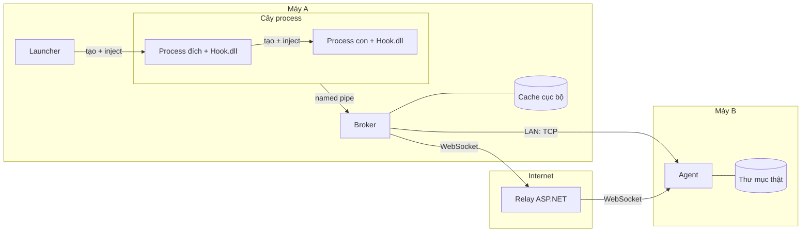
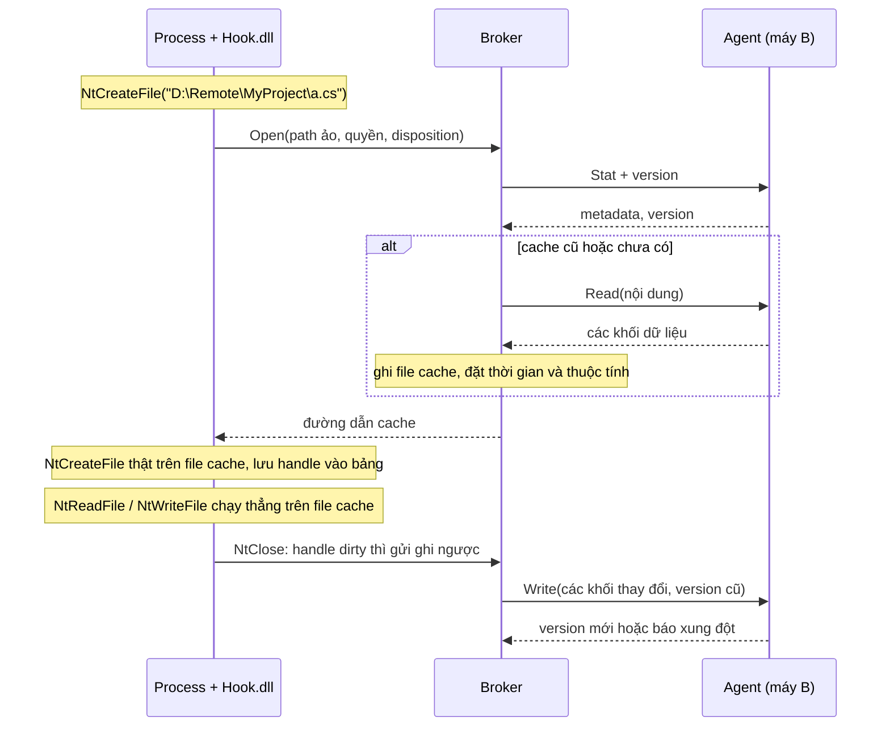
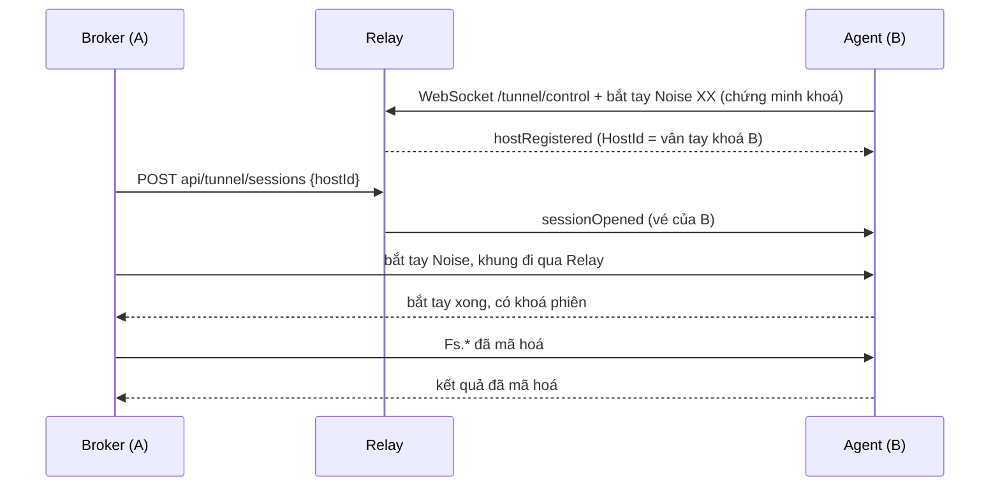

# ProcBridge — Kế hoạch thiết kế

> Trạng thái: đã xong M0 (bộ khung), M1 (spike hook cục bộ, mục 13.1), M2 (LAN chỉ đọc, mục 13.2) và M4
> (cây process, mục 13.3; ghép với máy B ở mục 13.4). Ngày lập: 2026-11-25.
> Việc còn treo: xem [Backlog-vi.md](Backlog-vi.md).
> Thuật ngữ: xem [Glossary-vi.md](Glossary-vi.md).

## Mục lục

1. [Mục tiêu và phạm vi](#1-mục-tiêu-và-phạm-vi)
2. [Kiến trúc tổng quan](#2-kiến-trúc-tổng-quan)
3. [Cấu trúc thư mục src](#3-cấu-trúc-thư-mục-src)
4. [Tầng hook (Hook.dll)](#4-tầng-hook-hookdll)
5. [Cây process: inject process cha và process con](#5-cây-process-inject-process-cha-và-process-con)
6. [Broker trên máy A](#6-broker-trên-máy-a)
7. [Giao thức A ↔ B](#7-giao-thức-a--b)
8. [Vận chuyển: LAN trực tiếp và Relay ASP](#8-vận-chuyển-lan-trực-tiếp-và-relay-asp)
9. [Mã hoá đầu cuối và ghép cặp](#9-mã-hoá-đầu-cuối-và-ghép-cặp)
10. [Cache, ghi và nhất quán](#10-cache-ghi-và-nhất-quán)
11. [Ghi chú theo từng mục đích sử dụng](#11-ghi-chú-theo-từng-mục-đích-sử-dụng)
12. [Chiến lược test](#12-chiến-lược-test)
13. [Các mốc (milestone)](#13-các-mốc-milestone)
14. [Duyệt tài nguyên máy B (Remote Explorer)](#14-duyệt-tài-nguyên-máy-b-remote-explorer)
15. [Rủi ro và câu hỏi mở](#15-rủi-ro-và-câu-hỏi-mở)

---

## 1. Mục tiêu và phạm vi

ProcBridge cho phép **một process cha và toàn bộ cây process con của nó** chạy trên máy A nhưng làm
việc với một thư mục nằm trên máy B, như thể thư mục đó có sẵn trên máy A. Process khác trên máy A
không thấy gì. Trong cây process, mọi đường dẫn ngoài thư mục ảo vẫn đi thẳng xuống hệ thống thật.

Đã chốt với user:

| Mục | Quyết định |
|---|---|
| Nền tảng | Chỉ Windows (cả máy A và máy B) |
| Phạm vi hook | Một process cha + mọi process con, cháu do nó tạo ra |
| Quyền | Đọc và ghi |
| Mục đích | Cả bốn: build/chạy công cụ trên source ở máy B, chạy app, chạy game, debug |
| Mạng | LAN kết nối trực tiếp; internet đi qua API ASP.NET trung gian (relay) |
| Bảo mật | Mã hoá đầu cuối A ↔ B, relay chỉ chuyển tiếp, không đọc được nội dung |
| Ngôn ngữ | Hook viết C++; launcher, broker, agent, relay viết C# |
| Duyệt máy B | Có chức năng duyệt từ xa: file/thư mục, registry, danh sách process… (mục 14) |

Mở rộng về sau (không nằm trong các mốc đầu): registry, socket (mở port, kết nối ra ngoài qua máy B),
biến môi trường, và các API khác theo cùng khuôn "chặn ở `ntdll` → chuyển sang máy B".

**Không làm** (ít nhất ở giai đoạn này):

- Mount cho toàn hệ thống (đã có SMB, WinFsp+SSHFS làm việc đó).
- Process dùng syscall trực tiếp, bỏ qua `ntdll` (hiếm; ghi nhận là giới hạn).
- Process được tạo bởi dịch vụ ngoài cây (COM out-of-process, `ShellExecute` qua Explorer, WMI,
  Task Scheduler, UWP broker). Các process đó không nằm trong cây nên không được hook.
- Vượt anti-cheat hoặc cơ chế chống inject của game. Game chặn inject thì ProcBridge không chạy được
  với game đó.

---

## 2. Kiến trúc tổng quan



Vai trò từng thành phần:

| Thành phần | Chạy ở | Việc |
|---|---|---|
| `Launcher` | Máy A | Đọc cấu hình phiên (thư mục ảo ↔ máy B), khởi động Broker, tạo process cha ở trạng thái suspended, inject `Hook.dll`, gán Job Object |
| `Hook.dll` (x64, x86) | Trong mọi process của cây | Chặn các hàm `Nt*` ở `ntdll`, nhận diện đường dẫn thuộc thư mục ảo, hỏi Broker; còn lại gọi hàm gốc |
| `Broker` | Máy A, một process mỗi phiên | Giữ kết nối tới máy B, mã hoá, quản lý cache, trả lời Hook qua named pipe |
| `Agent` | Máy B | Phục vụ thư mục thật theo danh sách chia sẻ, kiểm quyền, báo thay đổi |
| `Relay` | Server internet (tuỳ chọn) | Điểm vượt NAT: máy B chứng minh HostId bằng khoá định danh, relay ghép lane A ↔ B và chuyển tiếp khung đã mã hoá; không tài khoản, không lưu gì |

Lý do tách `Broker` khỏi `Hook.dll`: giữ phần code chạy trong process đích nhỏ, không có mạng, không có
crypto, không có .NET. Lỗi mạng hay crash Broker không kéo sập process đích; Hook chỉ trả mã lỗi
`STATUS_*` phù hợp. Đánh đổi là thêm một chặng IPC cục bộ, nhỏ so với độ trễ mạng.

---

## 3. Cấu trúc thư mục src

Theo quy tắc thư mục `src/`: gốc repo chỉ giữ `docs/`, `README.md`, file cấu hình repo và CI.
Phần Relay theo kiến trúc ASP chuẩn nhưng chỉ còn các tầng có nội dung. Relay không có tài khoản, máy, chia sẻ hay
quyền (bỏ ngày 2026-11-26, xem 8.2), nên không có `Database.*` và cũng không còn `Repositories.Abstractions` /
`Repositories`: không còn dữ liệu nào để lưu, kể cả trong bộ nhớ, ngoài sổ đăng ký kênh điều khiển và phiên đang sống
của `TunnelHub`. Các feature `Services.Accounts/Devices/Shares` và CLI quản lý `ProcBridge.Relay.Cli` cũng bị xoá vì hết
việc; chạy relay bằng chính `ProcBridge.Relay.Api`, xem trạng thái bằng `/health/live` và log.

```text
src/
├── ProcBridge.slnx                       # phần C#
├── ProcBridge.Native.sln                 # phần C++ (Hook, test native) — vcxproj chưa vào được slnx ổn định
├── Directory.Build.props / .targets / Directory.Packages.props / ProjectBuildProperties.targets
├── native/
│   ├── ProcBridge.Hook/                  # Hook.dll (C++, MinHook), build x64 + Win32
│   ├── ProcBridge.Inject/                # thư viện inject dùng chung (C++), kể cả inject khác kiến trúc
│   ├── ProcBridge.Spawn/                 # launcher native: tạo process suspended + inject (M1); helper inject cùng kiến trúc (mục 5)
│   └── tests/ProcBridge.NativeProbe/     # exe gọi đủ bộ API file để test so sánh (mục 12)
├── shared/
│   ├── ProcBridge.Protocol/              # định nghĩa message, framing, mã lỗi (C#)
│   ├── ProcBridge.Crypto/                # bắt tay, khoá phiên, mã hoá khung
│   └── ProcBridge.HookIpc/               # định dạng IPC Hook ↔ Broker (C# phía Broker; header C++ sinh từ đây)
├── client/
│   ├── ProcBridge.Launcher/              # CLI + về sau là UI
│   └── ProcBridge.Broker/
├── agent/
│   ├── ProcBridge.Agent/                 # thư viện + console (app người dùng, mục 15 câu 4)
│   ├── ProcBridge.Agent.Wpf.Core/        # ViewModel + dịch vụ của app WPF (không phụ thuộc WPF, test được)
│   └── ProcBridge.Agent.Wpf/             # app WPF máy B: host Agent, chia sẻ, ghép cặp, máy đã ghép cặp, hồ sơ quyền Explorer
├── relay/
│   ├── ProcBridge.Relay.Shared/
│   ├── ProcBridge.Relay.ViewModels/
│   ├── ProcBridge.Relay.Services.Common/ # mã lỗi, vé lane ngẫu nhiên (helper tĩnh, không đăng ký service)
│   ├── ProcBridge.Relay.Services.Tunnel/ # TunnelHub: bắt tay chứng minh HostId, ghép lane, giới hạn
│   ├── ProcBridge.Relay.Services/        # facade đăng ký mọi feature
│   ├── ProcBridge.Relay.Integration.Api/ # client typed (interface dùng chung với controller)
│   ├── ProcBridge.Relay.Api/             # POST api/tunnel/sessions + endpoint WebSocket /tunnel, /tunnel/control
│   └── tests/
└── tests/
    ├── ProcBridge.Tests/                 # test C# (protocol, crypto, broker, agent, end-to-end)
    └── ProcBridge.Agent.Wpf.Tests/       # test ViewModel của app WPF máy B
```

---

## 4. Tầng hook (Hook.dll)

### 4.1 Hook ở tầng nào

Hook ở **`ntdll`** (hàm `Nt*`), dùng MinHook (giấy phép BSD). Mọi API phía trên đều đi qua đây: Win32
(`CreateFileW`, `FindFirstFileW`), CRT, .NET (`FileStream`, `Directory.EnumerateFiles`), Java, Python.
Hook ở tầng Win32 thì hở nhiều đường đi vòng nên không chọn.

### 4.2 Danh sách hàm cần chặn (file)

| Nhóm | Hàm | Ghi chú |
|---|---|---|
| Mở/tạo | `NtCreateFile`, `NtOpenFile` | Điểm vào chính. Quyết định thật/ảo tại đây |
| Thuộc tính theo đường dẫn | `NtQueryAttributesFile`, `NtQueryFullAttributesFile` | `GetFileAttributes`, `PathFileExists` đi qua đây, không mở handle |
| Liệt kê thư mục | `NtQueryDirectoryFile`, `NtQueryDirectoryFileEx` | Trả danh sách từ máy B theo đúng `FILE_INFORMATION_CLASS` được hỏi |
| Thông tin theo handle | `NtQueryInformationFile`, `NtSetInformationFile` | Đổi tên, xoá (`FileDispositionInformation[Ex]`), đổi kích thước, thời gian, tên file |
| Đọc/ghi | `NtReadFile`, `NtWriteFile`, `NtFlushBuffersFile` | Với mô hình handle cache (4.4) phần lớn không cần chặn; chặn để đánh dấu dirty và cho tải theo vùng về sau |
| Đóng | `NtClose` | Kích hoạt ghi ngược khi handle dirty, dọn bảng handle |
| Theo dõi thay đổi | `NtNotifyChangeDirectoryFile`, `NtNotifyChangeDirectoryFileEx` | Mốc M7 |
| Tên handle | `NtQueryObject` (`ObjectNameInformation`), `NtQueryInformationFile` (`FileNameInformation`, `FileNormalizedNameInformation`) | Để `GetFinalPathNameByHandle` trả đường dẫn ảo chứ không lộ đường dẫn cache |
| Volume | `NtQueryVolumeInformationFile` | Tên ổ, serial, hệ thống file, dung lượng trống của thư mục ảo |
| Khoá | `NtLockFile`, `NtUnlockFile` | Chuyển sang máy B ở mốc sau; ban đầu khoá cục bộ trên file cache |
| Tạo process | `NtCreateUserProcess` | Mục 5; exe nằm trong thư mục ảo chạy từ bản sao (mục 13.7) |

### 4.3 Nhận diện đường dẫn ảo

Thư mục ảo được khai báo dạng: *đường dẫn trên máy A* → *(máy B, tên chia sẻ, thư mục con)*. Ví dụ
`D:\Remote\MyProject` → `B:share/src/MyProject`. Đường dẫn trên máy A **không cần tồn tại**; có thể
dùng cả ký tự ổ giả như `V:\`.

Đường dẫn tới hook dưới nhiều dạng, phải đưa về một dạng chuẩn trước khi so:

- NT path `\??\D:\...`, `\??\UNC\...`, `\Device\HarddiskVolumeN\...`.
- Đường dẫn tương đối theo `RootDirectory` trong `OBJECT_ATTRIBUTES` (handle thư mục, có thể là handle
  ảo do chính Hook cấp).
- Thư mục hiện hành của process (`SetCurrentDirectory` vào thư mục ảo phải chạy được: handle thư mục
  hiện hành là handle ảo).
- Tên ngắn 8.3, `..`, `.`, dấu `\` thừa, `\\?\` prefix, phân biệt hoa thường (so không phân biệt).
- Symlink, junction bên trong thư mục ảo: Agent trên máy B tự giải và chỉ cho phép trỏ trong phạm vi
  chia sẻ.

### 4.4 Mô hình handle: handle cache cục bộ

Đây là quyết định thiết kế quan trọng nhất của tầng hook.

- Khi process mở một file ảo, Hook hỏi Broker. Broker bảo đảm có **bản sao trong cache cục bộ**
  (`%LOCALAPPDATA%\ProcBridge\cache\<phiên>\...`), tải từ máy B nếu chưa có hoặc đã cũ.
- Hook gọi `NtCreateFile` **thật** trên file cache, trả handle thật đó cho process và ghi vào bảng
  `handle → đường dẫn ảo`.
- Nhờ vậy `NtReadFile`, `NtWriteFile`, memory-mapped file (`NtCreateSection`), overlapped I/O, IOCP
  đều chạy bằng cơ chế thật của Windows, không phải tự giả lập.
- Thứ bị lộ ra là **metadata và tên**: Hook sửa kết quả các hàm hỏi tên, thời gian, file ID, volume
  để process chỉ thấy thông tin của máy B và đường dẫn ảo. Thời gian và thuộc tính của file cache
  được đặt trùng với file gốc trên máy B ngay khi tải về.
- Thư mục ảo: handle là handle thật của một **thư mục giữ chỗ** trong cache. Kết quả liệt kê
  (`NtQueryDirectoryFile`) do Hook dựng từ danh sách của máy B, không đọc thư mục giữ chỗ.

Giới hạn: file rất lớn phải tải trọn mới mở được (M2). Mốc sau thêm tải theo vùng: file cache là
sparse file, Hook chặn `NtReadFile` trên vùng chưa có để kéo về trước khi đọc. Memory-mapped file trên
vùng chưa tải vẫn là điểm khó (ghi ở mục 14).



### 4.5 Ghi, tạo, đổi tên, xoá

- Tạo file mới (`FILE_CREATE`, `FILE_OVERWRITE_IF`…): Broker gửi lệnh tạo sang máy B trước (để báo
  đúng `STATUS_OBJECT_NAME_COLLISION`), rồi tạo file cache.
- Đổi tên, xoá, đổi thuộc tính: gửi đồng bộ sang máy B, thành công mới cập nhật cache. Trả mã lỗi
  của máy B cho process.
- Ghi nội dung: ghi vào file cache, đánh dấu dirty, gửi ngược khi `NtClose`, `NtFlushBuffersFile`,
  hoặc theo chu kỳ. Chi tiết nhất quán ở mục 10.

### 4.6 Quy tắc an toàn trong Hook

- Không cấp phát bằng CRT trong đường nóng nếu tránh được; không gọi API có thể quay lại chính hàm
  đang hook (cờ chống đệ quy theo thread).
- Không gọi `LoadLibrary` trong `DllMain`; khởi động hook ở một thread riêng hoặc qua APC trước khi
  process chạy entry point.
- Broker không trả lời trong thời gian giới hạn → trả `STATUS_IO_TIMEOUT` hoặc `STATUS_NETWORK_UNREACHABLE`,
  không treo vô hạn.
- Đường dẫn không thuộc thư mục ảo phải đi đường nhanh: một phép so tiền tố rồi gọi hàm gốc.

---

## 5. Cây process: inject process cha và process con

1. Launcher tạo process cha với `CREATE_SUSPENDED`, inject `Hook.dll` (thread từ xa gọi
   `LoadLibraryW`, hoặc APC vào thread chính), chờ Hook báo sẵn sàng qua pipe rồi `ResumeThread`.
2. `Hook.dll` chặn `NtCreateUserProcess`. Mỗi lần có process con: thêm cờ suspended vào tham số, gọi
   hàm gốc, inject vào con, rồi mới cho con chạy (nếu bên gọi vốn không yêu cầu suspended).
3. Cả cây được gán vào **một Job Object** (`JOB_OBJECT_LIMIT_KILL_ON_JOB_CLOSE`). Launcher dùng Job để
   biết cả cây đã thoát, khi đó đóng phiên, ghi ngược nốt dữ liệu, dọn cache theo cấu hình.
4. Khác kiến trúc: cha x64 sinh con x86 (WOW64) hoặc ngược lại. Hook nhờ Broker hoặc một helper đúng
   kiến trúc làm việc inject. Build cả `ProcBridge.Hook.x64.dll` và `ProcBridge.Hook.x86.dll`.
5. Process con kế thừa handle ảo từ cha (handle thật của file cache): bảng `handle → đường dẫn ảo`
   phải được chuyển cho con. Cách làm: cha chép các mục của handle ảo kế thừa vào khối khởi tạo của con
   (với Broker kèm metadata máy B và đường dẫn ảo), sau giao diện `IHandleInheritance` (mục 13.3, 13.4);
   không cần bảng chung của phiên trong Broker.

---

## 6. Broker trên máy A

- Một process .NET cho mỗi phiên, Launcher khởi động trước khi tạo process cha.
- Kênh với Hook: named pipe `\\.\pipe\ProcBridge-<phiên>`, ACL chỉ cho user hiện tại. Mỗi thread
  của process đích có thể gửi song song; dùng pipe chế độ message, nhiều instance.
- Quản lý: cache metadata (stat, danh sách thư mục) có TTL, cache nội dung file theo version, bảng
  handle của cả phiên, hàng đợi ghi ngược.
- Định dạng IPC Hook ↔ Broker là nhị phân cố định (struct có độ dài), không phải JSON, vì nằm trên
  đường nóng của mọi lần mở file ảo.

---

## 7. Giao thức A ↔ B

- **Một giao thức duy nhất** cho mọi đường vận chuyển (TCP LAN hay WebSocket qua relay). Relay không
  hiểu nội dung giao thức (mục 9).
- Khung (frame): `[độ dài][stream id][loại][payload]`, sau lớp mã hoá. Nhiều request chạy song song
  trên cùng một kết nối, mỗi request một `stream id`.
- Truyền file lớn: chia khối (vd 256 KB), có điều khiển luồng để một file lớn không chặn các request metadata nhỏ:
  - **Cửa sổ tín dụng** (`CreditWindow`, phía Broker, mỗi chiều một cửa sổ cho cả pool): dữ liệu file đang bay (khối
    `FsRead` đang chờ trả lời, khối `FsWrite` đang gửi) không vượt kích thước cửa sổ; khối mới chờ tới khi khối cũ về.
    Kích thước bám theo đường truyền: `tốc độ giao × max(100 ms, 2 × RTT) + một khối`, kẹp trong
    [`DataWindowMin` 512 KB, `DataWindowMax` 16 MB]; RTT là RTT nhỏ nhất của bắt tay `Hello` (lúc kết nối còn rảnh),
    không lấy độ trễ của chính các khối vì nó gồm cả hàng đợi do cửa sổ tạo ra. Vậy cửa sổ luôn ≥ tích băng thông × độ
    trễ cộng một khối (đường truyền vẫn đầy) mà hàng đợi trước request nhỏ chỉ cỡ 0,1 s dữ liệu. Trước đây mỗi file giữ
    8 khối 256 KB đang bay, vài file cùng lúc là vài MB nằm trong buffer socket và trên mạng, request metadata phải xếp
    sau hết (số đo ở 13.7).
  - **Ưu tiên khung nhỏ** (`FrameSendGate` trong `StreamFrameChannel`, cả hai phía): khung ≤ 32 KB (request,
    metadata, `Ping`, file nhỏ) đang chờ gửi được đi trước khung dữ liệu lớn chờ cùng kết nối; sau 16 khung nhỏ liền
    nhau thì một khung lớn được đi để dữ liệu không bị bỏ đói.
- Tuần tự hoá: MessagePack hoặc protobuf (chốt ở M2). Có số phiên bản giao thức trong bắt tay.
- Nhóm message theo "miền" để sau này thêm registry, socket mà không đổi khung: `Fs.*` (Stat, List,
  Open, Read, Write, Rename, Delete, SetInfo, Watch), `Sys.*`, `Proc.*`, `Reg.*` cho chức năng duyệt
  (mục 14), về sau `Net.*`.
- Mã lỗi: chuyển nguyên `NTSTATUS` từ máy B về, để process đích nhận đúng lỗi như khi chạy cục bộ.
- Phát hiện kết nối treo (keepalive): kết nối không nhận được khung nào, hoặc không gửi đi khung nào (kết nối chỉ nhận
  thông báo của watch), trong `KeepAliveInterval` (mặc định 15 s), hoặc vừa có request quá hạn, thì phía A gửi `Ping` (0x0002, header rỗng). Agent trả `Ping` ngay trong vòng đọc, ngoài giới
  hạn request đồng thời. Trong `KeepAliveTimeout` (mặc định 20 s) mà không nhận được khung nào (khung trả lời lớn đang về
  cũng tính là còn sống) thì kết nối bị đánh dấu chết: request đang chờ lỗi kiểu mất kết nối, request idempotent được
  pool gửi lại trên kết nối mới, thay vì mỗi request chờ đủ `RequestTimeout`. `Ping` đi đầu cuối nên qua lane relay cũng
  vậy. Ngược lại, Agent đóng kết nối im lặng quá `IdleTimeout` (mặc định 2 phút) để máy A biến mất không giữ handle và
  khoá mãi. `Ping` và luật im lặng này có từ giao thức 3; Broker cũ (giao thức 2) bị từ chối ở Hello.
- Liệt kê thư mục theo trang (`FsList`, `StartIndex`): trang đầu (`StartIndex` 0) luôn quét và sắp xếp thư mục mới;
  thư mục trên 256 mục giữ bản quét đó tới khi 10 giây không có trang nào dùng tới (`DirectoryListingCache`, mỗi share tối đa 8 thư mục) để các trang sau
  cắt từ cùng bản quét thay vì quét lại cả thư mục mỗi trang (trước đây O(n²) với thư mục rất lớn). Cache theo share chứ
  không theo kết nối vì các trang có thể đi qua những kết nối khác nhau của pool. Các trang sau thấy thư mục như lúc
  trang đầu, nên thay đổi xen giữa hai trang không làm lặp hay sót mục khi phân trang theo chỉ số. Bản quét hết hạn bị
  bỏ ở lần gọi kế tiếp bất kỳ. Giới hạn (`FsList` không mang danh tính client): hai client cùng liệt kê một thư mục dùng
  chung một bản quét, trang đầu của client này thay bản quét client kia đang phân trang (các trang sau của nó lấy từ bản
  quét mới hơn, như khi không có cache); dừng quá 10 giây giữa hai trang thì quét lại.

---

## 8. Vận chuyển: LAN trực tiếp và Relay ASP

### 8.1 LAN

Broker kết nối TCP thẳng tới Agent (cổng cấu hình được). Tìm Agent trong LAN bằng nhập địa chỉ tay
(M2), về sau thêm dò mDNS hoặc UDP broadcast.

### 8.2 Internet qua Relay ASP.NET

- Relay là điểm vượt NAT **tuỳ chọn**: LAN hoặc máy B có port public vẫn nối TCP thẳng (8.1). Cả Broker và Agent
  đều **chủ động kết nối ra** Relay bằng WebSocket (TLS), không cần mở port ở hai máy.
- Relay **không có tài khoản** và không lưu gì (quyết định 2026-11-26): không tài khoản, máy, chia sẻ, quyền, token
  máy/phiên, REST quản lý hay CLI quản lý. Ai được nói chuyện với ai do bắt tay Noise IK đầu cuối quyết định (mục 9):
  máy B chỉ nhận máy A đã ghép cặp, relay chỉ thấy byte đã mã hoá.
- Giao thức tunnel (M6):
  - **HostId** của máy B = vân tay khoá định danh Noise của nó (`KeyFingerprint`). Máy B giữ kênh điều khiển
    `GET /tunnel/control` (WebSocket, không token) và **phải chứng minh sở hữu khoá**: chạy bắt tay Noise XX
    (initiator) với relay, prologue `ProcBridge relay control v1`. Relay sinh khoá tĩnh riêng mỗi lần khởi động; tin
    nhắn 3 chỉ giải mã được khi B có khoá bí mật, khoá tạm của relay làm bản phát lại vô dụng. Relay đăng ký kênh theo
    vân tay khoá vừa được chứng minh và gửi `hostRegistered {hostId}`; B kiểm hostId đúng vân tay của mình. Không ai
    đăng ký được HostId của máy khác; kênh mới của cùng khoá thay kênh cũ. Bắt tay quá `ControlHandshakeTimeout`
    (10 giây) hoặc sai thì relay đóng kênh.
  - Máy A gọi `POST api/tunnel/sessions {hostId}` (ẩn danh), hostId lấy từ máy đã ghép cặp trong
    `PairedMachineStore` (Broker tính từ `AgentPublicKey`). Relay tạo phiên với hai vé ngắn hạn (một cho mỗi phía), trả
    vé của A và đẩy `sessionOpened {sessionId, ticket, expiresAt}` cho B qua kênh điều khiển. HostId không online thì 409
    `HOST_OFFLINE`.
  - Hai phía mở các lane dữ liệu `GET /tunnel?sessionId=..&lane=N` (WebSocket) kèm vé trong header
    `Authorization: Bearer pbt_...` (vé không nằm trong URL để khỏi lọt vào log proxy; `?ticket=` chỉ nhận khi
    bật `Relay:Tunnel:AllowTicketInQuery`, mặc định tắt). Lane cùng số của hai phía được ghép cặp; relay chép nguyên
    khung nhị phân giữa chúng, không đọc payload. Một phiên có tối đa 16 lane song song (quyết định 1 ở mục 15). Đóng
    một đầu thì đóng đầu kia của cùng lane.
  - Máy A mở lane theo nhu cầu (mỗi kết nối của pool là một lane, lấy số nhỏ nhất còn trống). Khi đầu
    của A tới trước, relay đẩy `laneRequested {sessionId, lane}` qua kênh điều khiển và máy B mở đúng lane
    đó bằng vé của mình; máy B không phải mở sẵn lane chờ.
  - Bắt tay Noise IK và mã hoá khung (mục 9) chạy BÊN TRONG mỗi lane, y như trên một kết nối TCP ở LAN:
    relay chỉ thấy byte đã mã hoá. Phía A là `RelayStreamConnector` dưới `SecureConnectionFactory`, phía B
    là `RelayHostLink` chuyển từng lane cho `SecureServer` của Agent (project `ProcBridge.Transport.Relay`).
  - Cấu hình chỉ còn URL relay: Agent console `--relay <url>`, app WPF của Agent có ô relay; Launcher console
    `--relay <url> --agent-fingerprint <fp>` (HostId chính là vân tay đó), Launcher WPF có mục "Kết nối qua relay"
    trong hồ sơ, HostId lấy từ máy đã ghép cặp của hồ sơ.
  - **Ghép cặp qua relay** (khi máy A chỉ thấy máy B qua relay, chưa biết khoá hay HostId của B): xem mục 9, phần
    "Ghép cặp qua relay". Relay chỉ giữ một **chỗ ghép cặp** mỗi máy B, tra theo khoá dẫn xuất từ mã mời 8 số; tra cứu
    `POST api/tunnel/pairing-sessions {lookupKey}` mở một phiên tunnel thường tới B và trả kèm HostId.
  - Chống lạm dụng: giới hạn tần suất theo địa chỉ cho mở phiên, kênh điều khiển và lane (`Relay:RateLimit`,
    mặc định 60/20/600 mỗi phút, quá thì 429), tra cứu chỗ ghép cặp `PairingPermitLimit` (mặc định 10 mỗi phút **theo dải
    mạng** IPv4 /24 hoặc IPv6 /64, mỗi lần là một lần đoán mã) cộng trần số lần tra sai toàn relay
    `Relay:Tunnel:MaxFailedPairingLookupsPerMinute` (mặc định 1000/phút) và số lần xin chỗ mỗi kênh điều khiển
    `MaxPairingSlotRequestsPerMinute` (30/phút); trần số phiên sống mỗi HostId và mỗi địa chỉ (`MaxSessionsPerHost`,
    `MaxSessionsPerAddress`, mặc định 64), số kênh điều khiển mỗi địa chỉ (16), số lane mỗi địa chỉ (256); trần kích
    thước message điều khiển; vé lane ngẫu nhiên 256 bit qua header. Relay chỉ tin `X-Forwarded-For` từ proxy khai
    trong `Relay:ForwardedHeaders:KnownProxies`/`KnownNetworks` (mặc định rỗng: không tin header nào).
- Lưu trữ: không có. Relay chỉ giữ kênh điều khiển và phiên đang sống trong bộ nhớ một tiến trình; khởi động lại thì
  mọi kênh và phiên rơi, máy B tự nối lại và chứng minh lại khoá. Không lưu nội dung file, không có log phiên bền.
- Về sau có thể thử kết nối thẳng P2P (UDP hole punching) và chỉ dùng relay khi thất bại; không nằm
  trong các mốc đầu.

---

## 9. Mã hoá đầu cuối và ghép cặp

- Mỗi máy (Broker phía A, Agent phía B) có **cặp khoá định danh lâu dài** (Ed25519 hoặc X25519), sinh
  khi cài, lưu bằng DPAPI.
- **Ghép cặp** lần đầu: máy B hiển thị mã ngắn, người dùng nhập ở máy A, nối thẳng (LAN) hoặc qua Relay
  (internet, tìm máy B bằng mã mời, xem "Ghép cặp qua relay" bên dưới). Kết quả: mỗi bên lưu khoá công khai của bên
  kia. Relay chỉ chuyển byte đã mã hoá; người dùng so vân tay khoá để chống Relay tráo khoá.
- **Mỗi phiên**: bắt tay theo mẫu Noise IK (hoặc XX) trên nền X25519, ra khoá phiên, mã hoá khung bằng
  ChaCha20-Poly1305 hoặc AES-GCM, có số thứ tự chống phát lại.
- Lớp mã hoá này giống nhau ở LAN và internet, nên Relay chỉ là một đường ống. Ở LAN không cần TLS
  riêng.

Đã chốt ở M5 (thư viện `ProcBridge.Crypto`, chưa gắn transport):

- Khoá định danh là **X25519** (cũng là khoá tĩnh Noise), qua NSec (libsodium). Vân tay: SHA-256 có
  nhãn, 20 byte đầu, base32 chia 8 nhóm 4 ký tự. File khoá bọc DPAPI (CurrentUser), ghi nguyên tử.
- **Tự cài Noise** `Noise_XX_25519_ChaChaPoly_SHA256` (ghép cặp) và `Noise_IK_25519_ChaChaPoly_SHA256`
  (phiên sau ghép cặp) trên NSec X25519 + ChaCha20-Poly1305/HMAC-SHA256 của .NET, kiểm bằng vector
  cacophony. Lý do: gói Noise.NET duy nhất trên NuGet ngừng bảo trì từ 2018.
- Một phiên nhiều kết nối: mỗi kết nối là một kênh có id (initiator số chẵn, responder số lẻ, mỗi id
  dùng một lần), khoá kênh = HKDF(khoá chiều, salt = handshake hash, info = id), nên không bao giờ
  trùng cặp khoá/nonce giữa các kết nối.
- Khung: `[counter 8 byte][ciphertext][tag 16 byte]`, AD gồm counter + id kênh + header rõ của tầng
  trên. Bên nhận chỉ nhận đúng counter kế tiếp (chống phát lại/đảo thứ tự, vì TCP/WebSocket có thứ tự).
  Rekey kiểu Noise REKEY mỗi 2^20 khung, hai bên tự làm theo counter.
- Ghép cặp: chạy trong phiên XX, kiểu commit-rồi-reveal (A cam kết nonce, B gửi nonce, A lộ nonce),
  mã 6 chữ số = SHA-256(h, Na, Nb). Kẻ đứng giữa chỉ có 1/10^6 cơ hội mỗi lần thử. A nhập mã một lần;
  B vẫn cần người dùng bấm chấp nhận sau khi A báo thành công, vì kênh người dùng chỉ đi một chiều B→A.
- Ngoài ghép cặp, bắt tay luôn phải có delegate kiểm khoá bên kia. Chỉ `NoiseHandshake.CreatePairing`
  nhận khoá lạ; phiên của nó chưa tin cậy, chỉ mở được kênh ghép cặp dành riêng (`GetPairingChannel`),
  kênh dữ liệu bị chặn tới khi `ConfirmCode` (A) / `Accept` (B) thành công.
- Nhiều luồng cùng gửi trên một kênh thì dùng `SealAndWriteAsync` để khung lên dây đúng thứ tự counter.
- Payload của message 1 bắt tay phát lại được, tầng trên không coi nó là lệnh.

Đã gắn vào transport (nhánh `feature/secure-transport`, project `ProcBridge.Transport.Secure`):

- Mỗi kết nối TCP mở đầu bằng phần rõ `magic "PBS1" | op`. `Handshake`: Noise IK (prologue
  `ProcBridge/<ProtocolInfo.Version>`), Agent kiểm khoá A bằng kho máy đã ghép cặp và đóng kết nối nếu lạ, rồi A gửi
  id kênh. `Join`: kết nối phụ gửi rõ `id phiên (16 byte đầu handshake hash) | id kênh`, Agent trả một byte chấp
  nhận / không biết phiên (A bắt tay lại). Một lần bắt tay phục vụ mọi kết nối của pool. Sau đó khung đi qua
  `IFrameProtector` (`SecureFrameProtector` = `SecureChannel.Seal/Open`) trong `StreamFrameChannel`.
- `Pairing`: Noise XX, rồi trên kênh ghép cặp: tên A, commit, nonce, reveal; Agent phát `PairingRequested` (mã 6 số
  + vân tay A + tên), confirm của A chứng minh mã khớp, chỉ `Accept` của người dùng B mới lưu khoá A; tin cuối báo
  quyết định và tên B, A lưu khoá B kèm địa chỉ. Ghép cặp tắt mặc định (`AllowPairing`).
- Kho `PairedMachineStore` (JSON bọc DPAPI, liệt kê vân tay, thu hồi) dùng cho cả A và B; thu hồi đóng ngay các
  kết nối của máy đó ở Agent và từ chối bắt tay/join mới, đồng thời xoá hồ sơ Explorer của vân tay đó. File là nguồn
  sự thật: kho tự tải lại khi mtime/kích thước file đổi (bắn `Revoked` cho máy biến mất), mọi lần ghi lấy khoá liên
  tiến trình, đọc lại file rồi chỉ áp thay đổi của mình (không ghi đè bằng danh sách cũ trong RAM); Agent quét lại hai
  file mỗi `TrustRefreshInterval` (2 giây) để thu hồi từ tiến trình khác cũng cắt kết nối đang mở.
- Chống kết nối chưa xác thực: `MaxPendingHandshakes` (64) toàn cục và `MaxPendingHandshakesPerAddress` (8) theo IP,
  vượt thì đóng ngay; chỉ một phiên ghép cặp chờ người dùng tại một thời điểm; tắt `AllowPairing` huỷ phiên đang chờ.
  Phía A bắt tay và join bị chặn bởi `TransportOptions.HandshakeTimeout`.
- Agent và Broker mặc định bắt buộc mã hoá; `AllowPlaintextTransport` (`--plaintext`) chỉ cho phát triển và test cũ.

Ghép cặp qua relay (nhánh `feature/relay-pairing`, quyết định 2026-11-26):

- Vấn đề: máy A chỉ tới được máy B qua relay mà chưa biết khoá hay HostId của B, nên chưa mở được phiên theo HostId.
  Không thêm tài khoản: máy B mở một **chỗ ghép cặp** (pairing slot) tạm trên relay, máy A tìm nó bằng **mã mời**.
- Máy B (Agent bật `AllowPairing` và có relay): `RelayHostLink` sinh mã mời ngẫu nhiên 8 chữ số (`RelayPairingCode`,
  hiện dạng `1234-5678`; cố ý khác độ dài mã 6 số để khỏi nhầm), gửi trên kênh điều khiển đã chứng minh khoá
  `pairingSlot {lookupKey}` với `lookupKey` = hex SHA-256(nhãn `ProcBridge relay pairing v1` | mã). Relay trả
  `pairingSlotRegistered {lookupKey, expiresAt, expiresInSeconds}`, lúc đó Agent mới hiện mã (console in ra, app WPF hiện
  cạnh trạng thái relay). Mỗi máy B một chỗ; chỗ sống `Relay:Tunnel:PairingSlotLifetime` (mặc định 5 phút), dùng một lần,
  mất theo kênh điều khiển; khoá trùng với chỗ của máy khác thì relay trả `pairingSlotRejected` và B chọn mã khác. B tự
  mở chỗ mới với mã mới khi chỗ sắp hết hạn, bị dùng (`pairingSlotClaimed`, kể cả khi relay lấy chỗ ra mà không mở được
  phiên, lúc đó `sessionId` rỗng) hoặc kênh điều khiển nối lại; tắt ghép cặp thì gửi `pairingSlotCancel`.
- Thứ tự và đồng hồ ở máy B: chỉ một vòng gửi duy nhất trong `RelayHostLink`, mỗi lần được đánh thức nó gửi trạng thái
  **mong muốn hiện tại** (chỗ với khoá đang chờ, hoặc huỷ) nếu khác lần gửi trước, nên thông điệp không thể tới sai thứ
  tự. Relay báo đã giữ một khoá cũ (trả lời đến muộn) thì vòng gửi đặt lại chỗ đúng hoặc huỷ. Hạn của chỗ tính bằng
  `expiresInSeconds` cộng giờ nhận trên đồng hồ của B (không so `expiresAt` của relay với đồng hồ B), xin mã mới sớm
  `PairingRenewMargin` (5 giây, tối đa một phần tư thời gian sống). Relay từ chối quá `MaxPairingRejections` (5) mã liên
  tiếp thì B hiện lỗi (`PairingError`, console in ra, app WPF ghép vào trạng thái relay) và thử lại với độ trễ tăng dần
  (2 giây tới 60 giây).
- Máy A (`RelayPairingConnector`): tính lại `lookupKey` từ mã người dùng nhập, gọi `POST api/tunnel/pairing-sessions`
  (ẩn danh, giới hạn tần suất). Relay lấy chỗ ra (dùng một lần, đoán sai không làm mất chỗ của B), mở phiên tunnel
  thường tới B và trả `{sessionId, ticket, expiresAt, hostId}`; không có chỗ thì 404 `PAIRING_SLOT_NOT_FOUND`. A mở lane
  0 và chạy `PairingClient` y như ở LAN (Noise XX, mã 6 số, B bấm chấp nhận sau khi so vân tay A). Trước khi hỏi mã,
  `PairingClient` so vân tay khoá tĩnh trong tin nhắn 2 của bắt tay với HostId relay đã nêu (`IPeerHintConnector`) ngay
  sau khi đọc tin nhắn 2, trước khi gửi tin nhắn 3; lệch hoặc không có khoá thì dừng, không gửi gì thêm.
  Máy đã ghép cặp kiểu này lưu địa chỉ `relay <url>`; các lần sau đi qua relay theo HostId như mục 8.2.
- Vì sao an toàn: relay chỉ thấy `lookupKey`. Mã mời 8 số **không phải bí mật đối với relay** (đoán ngược từ hash rất
  nhanh), nó chỉ để tìm máy B. Chống kẻ đứng giữa vẫn là mã 6 số dẫn xuất từ handshake hash cộng việc hai người dùng so
  vân tay; relay tráo máy thì vân tay lệch HostId hoặc lệch màn hình.
- **Rủi ro chấp nhận** (đoán mã mời): không gian mã là 10^8. Một người đoán bị chặn 10 lần/phút mỗi dải /24 hoặc /64 và
  cả relay chỉ nhận tối đa 1000 lần tra sai mỗi phút; với N máy B đang mở chỗ, mỗi lần đoán trúng một chỗ nào đó với xác
  suất N/10^8 (vd 1000 chỗ: 10^-5, tức tối đa khoảng 0,01 lần trúng mỗi phút khi đã chạm trần toàn relay). Trúng cũng
  chỉ mở được một phiên ghép cặp: kẻ đoán không có mã 6 số mà máy B hiển thị (mã đó sinh từ handshake hash), và người
  dùng B vẫn phải so vân tay của kẻ đó rồi bấm chấp nhận. Cái giá chấp nhận được: kẻ đoán trúng làm hỏng một mã của máy
  B (máy B đổi mã) và có thể bật hộp thoại ghép cặp trên máy B; trần toàn relay cũng có nghĩa một đợt đoán ồ ạt làm người
  dùng thật phải chờ tới phút sau mới tra được. Không dùng hàm băm chậm vì relay vẫn đoán ngược được 10^8 mã, và bảo
  mật thật nằm ở mã 6 số với việc so vân tay.
- Giao diện: Agent console `--relay <url> --allow-pairing` in mã; Launcher console
  `--pair --relay <url> [--code <mã>]`; app WPF của Launcher có ô "Máy B chỉ thấy qua relay" (URL relay + mã 8 số) và
  Remote Explorer đi qua relay cho máy ghép cặp kiểu này. Test: `PairingSlotTests` (relay e2e), `RelayPairingTests`
  (ghép cặp qua relay đầu cuối rồi mở phiên theo HostId).
- Hồ sơ chạy của app WPF Launcher chọn máy ghép cặp qua relay (địa chỉ `relay <url>`) thì tự bật "Kết nối qua relay"
  với URL đó (giữ nguyên nếu hồ sơ đã có relay riêng); `LaunchOptionsFactory` dùng relay của máy khi hồ sơ không ghi
  relay. App WPF của Agent nghe `IAgentHost.RelayStatusChanged` (từ `RelayHostLink.PairingCodeChanged` và
  `ConnectionChanged`) nên mã mời mới hiện ngay, không chờ lượt làm mới 1 giây của cửa sổ.



---

## 10. Cache, ghi và nhất quán

- Mỗi file trên máy B có **version** (tổ hợp thời gian sửa + kích thước + file ID, hoặc số đếm do Agent
  giữ). Broker so version trước khi dùng cache.
- **Đọc**: metadata có TTL ngắn (cấu hình được), nội dung dùng lại nếu version khớp.
- **Ghi**: mặc định ghi ngược khi đóng file hoặc flush. Có chế độ ghi xuyên (write-through) cho dữ liệu
  quan trọng, đổi bằng cấu hình theo thư mục.
- **Xung đột** (file trên máy B đã đổi kể từ lúc tải về): mặc định không ghi đè; giữ bản của A thành
  file `*.procbridge-conflict-<thời gian>` trên máy B và báo trong log, Launcher hiển thị cảnh báo.
  Có tuỳ chọn "bên A thắng".
- **Theo dõi thay đổi** (M7): Agent dùng `ReadDirectoryChangesW` trên máy B và đẩy sự kiện về Broker để
  làm mất hiệu lực cache, đồng thời phục vụ `NtNotifyChangeDirectoryFile` của process đích (IDE, công
  cụ build theo dõi file).
  Hook ↔ Broker: mỗi process chỉ giữ MỘT long poll `WaitAnyChanges` trên một pipe instance riêng, gom thay đổi của
  mọi handle đang theo dõi (Broker trả theo từng watchId, thêm watch mới thì poll đang chờ trả rỗng để Hook poll lại).
  Hook đệm thay đổi theo từng handle như bộ đệm notify của kernel, nên process mở hàng trăm handle theo dõi vẫn chỉ
  tốn một thread và một pipe instance (2026-11-26).
- Mất kết nối giữa phiên: dữ liệu dirty được giữ trong cache và hàng đợi, kết nối lại thì gửi tiếp.
  Đọc file chưa có trong cache thì trả lỗi mạng.

---

## 11. Ghi chú theo từng mục đích sử dụng

| Mục đích | Điểm cần chú ý |
|---|---|
| Build/chạy công cụ trên source máy B | Rất nhiều lần stat, liệt kê thư mục, đọc file nhỏ: tối ưu metadata (lấy cả cây con một lần, đọc trước file nhỏ). Ghi ra `bin/obj`: cân nhắc cấu hình **thư mục loại trừ** để đầu ra build nằm cục bộ trên máy A |
| Chạy app | Cần `GetFinalPathNameByHandle`, thư mục hiện hành, memory-mapped file, khoá file đúng |
| Chạy game | File asset rất lớn: cần tải theo vùng; anti-cheat có thể chặn inject (không xử lý) |
| Debug | Debugger (vd Visual Studio) là process cha thì process được debug là con và cũng được hook. File pdb, source đọc qua thư mục ảo. Cần test riêng với VS và VS Code |

---

## 12. Chiến lược test

- **Test so sánh (differential)**: `ProcBridge.NativeProbe` chạy cùng một kịch bản API (mở, đọc, ghi,
  liệt kê với mọi `FILE_INFORMATION_CLASS`, đổi tên, xoá, khoá, memory map) hai lần: trên thư mục thật
  và trên thư mục ảo trỏ tới đúng thư mục đó. Kết quả và mã lỗi phải giống nhau. Đây là xương sống
  của bộ test hook.
- Test theo runtime: cùng kịch bản viết bằng .NET, Python, `cmd`/PowerShell, để chắc mọi đường đi đều
  qua hook.
- Test cây process: `cmd /c` gọi tiếp `cmd /c` nhiều tầng, con x86 từ cha x64 và ngược lại.
- Test mạng: Agent và Broker trên cùng máy (localhost) trong CI; thêm giả lập trễ và mất gói.
- Test thực tế theo mục đích: `dotnet build` và `msbuild` một solution nằm trên máy B, mở bằng VS Code,
  chạy một app WPF, debug một console app.

---

## 13. Các mốc (milestone)

Mỗi mốc là một nhánh riêng, xong mốc nào build, test và commit mốc đó.

| Mốc | Nội dung | Điều kiện xong |
|---|---|---|
| **M0** Bộ khung | Cấu trúc `src/`, solution C# và C++, build x64 + x86, CI build | CI xanh, `Hook.dll` hai kiến trúc ra được |
| **M1** Spike hook cục bộ | Hook `ntdll` trong một process, chuyển hướng thư mục ảo sang một thư mục **cục bộ khác** (chưa có mạng). Kèm `NativeProbe` và test so sánh | `cmd /c type`, `dir`, .NET `File.ReadAllText`, Notepad mở/lưu được file qua thư mục ảo; test so sánh xanh với bộ API đọc |
| **M2** LAN chỉ đọc | Broker, Agent, giao thức, TCP; stat, liệt kê, tải trọn file vào cache | Mốc M1 chạy lại được với thư mục nằm ở máy B qua LAN |
| **M3** Ghi | Tạo, ghi, đổi tên, xoá, đặt thuộc tính, ghi ngược, phát hiện xung đột | Test so sánh xanh với bộ API ghi; sửa và lưu file trong VS Code |
| **M4** Cây process | Hook `NtCreateUserProcess`, inject con, x86/x64, Job Object, chuyển bảng handle | `dotnet build` chạy trên solution ở máy B (nhiều process con) |
| **M5** Mã hoá đầu cuối | Khoá định danh, ghép cặp, bắt tay Noise, mã hoá khung (áp cả LAN) | Bắt gói trên dây không thấy nội dung; ghép cặp sai khoá bị từ chối |
| **M6** Relay ASP | Relay theo kiến trúc ASP chuẩn, không tài khoản, không lưu gì: máy B chứng minh HostId bằng bắt tay Noise, máy A mở phiên theo HostId, tunnel WebSocket | Máy A và máy B ở hai mạng khác nhau làm được M4 qua Relay; không chiếm được HostId của máy khác |
| **M7** Theo dõi thay đổi và hiệu năng | `ReadDirectoryChangesW` phía B, `NtNotifyChangeDirectoryFile` phía A, lấy cây metadata một lần, đọc trước | IDE thấy file đổi trên máy B; đo thời gian build so với chạy cục bộ |
| **M8** Hoàn thiện theo mục đích | Tải theo vùng cho file lớn, khoá file chuyển sang máy B, test app/game/debug | Danh sách test thực tế ở mục 12 chạy được |
| **M9** Remote Explorer mở rộng | Danh sách process, registry, service, thông tin hệ thống (mục 14); thao tác ghi (kill process, sửa registry) sau cùng | Duyệt được cả bốn loại qua LAN và qua Relay; quyền bị tắt thì Agent từ chối |
| Sau M9 | Hook registry (`Reg.*` cho process đích), socket (`Net.*`) | Lập kế hoạch riêng |

Phần Remote Explorer **duyệt file/thư mục và ổ đĩa** đi kèm M2 (chỉ đọc) và M3 (thao tác file), vì
người dùng cần nó để chọn thư mục máy B trước khi mở phiên.

### 13.1 Kết quả M1 (2026-11-25)

- `ProcBridge.Hook` chặn `NtCreateFile`, `NtOpenFile`, `NtQueryAttributesFile`,
  `NtQueryFullAttributesFile`, `NtQueryInformationByName`, `NtDeleteFile`, `NtQueryInformationFile`
  (tên: class 9, 18, 48), `NtSetInformationFile` (chỉ dịch đường dẫn đích của đổi tên/tạo link),
  `NtQueryObject` (`ObjectNameInformation`), `NtClose`.
- `RootDirectory` là handle thư mục thật (kernelbase dùng handle thư mục hiện hành cho mọi đường dẫn nằm
  dưới thư mục hiện hành): Hook lấy tên thiết bị của handle đó (cache theo handle), ghép với tên tương đối,
  thuộc gốc ảo thì viết lại thành đường dẫn thật tuyệt đối. Gốc ảo lồng nhau: gốc dài nhất thắng; `:` sau
  gốc ảo (luồng dữ liệu phụ) cũng là ranh giới. Không nhận gốc ổ đĩa hay đường dẫn UNC làm thư mục ảo/thật.
- Con trỏ của process gọi vào được đọc/ghi qua SEH: con trỏ hỏng thì trả `STATUS_ACCESS_VIOLATION` như
  hệ thống, không làm sập process.
- Theo mô hình 4.4 rút gọn: thư mục thật đóng vai "cache", mở đường dẫn ảo là mở file thật, trả handle
  thật và ghi vào bảng `handle → ánh xạ`. Đọc, map bộ nhớ, overlapped I/O và liệt kê thư mục chạy trên
  handle thật nên **không** chặn `NtReadFile`/`NtQueryDirectoryFile` ở M1 (liệt kê chỉ trả tên lá).
  M2 sẽ chặn `NtQueryDirectoryFile[Ex]` để dựng danh sách từ máy B.
- Cấu hình: biến môi trường `PROCBRIDGE_MAP` (`ảo*thật|ảo*thật`), đọc sau giao diện `IPathResolver`;
  M2 thay bằng client Broker cùng giao diện.
- Khởi động: `DllMain` không làm gì nặng; injector gọi export `ProcBridgeHookInitialize` bằng thread từ
  xa sau `LoadLibraryW`, trước khi resume thread chính.
- Launcher M1 là `ProcBridge.Spawn` (native, dùng `ProcBridge.Inject`); Launcher C# dùng nó từ M2.
  Đích khác kiến trúc với Spawn bị từ chối sớm (`ERROR_EXE_MACHINE_TYPE_MISMATCH`, inject chéo kiến trúc
  là M4).
- Kiểm: `cmd /c type`, `dir`, `cd` vào thư mục ảo, .NET Framework `File.ReadAllText` (qua PowerShell 5.1),
  test so sánh `NativeProbe` thật/ảo giống từng dòng, cả x64 và Win32
  (`src/tests/ProcBridge.Tests/Native`). Notepad **chưa kiểm**: Notepad trên Windows 11 là app packaged,
  `notepad.exe` chỉ kích hoạt app nằm ngoài cây process (giới hạn đã nêu ở mục 1).

### 13.2 Kết quả M2 (2026-11-25)

- Hook nói chuyện với Broker qua `\\.\pipe\ProcBridge-<phiên>` (định dạng `ProcBridge/HookIpc.h`): pool instance
  có khoá (mỗi lời gọi lấy một instance rảnh hoặc mở mới), chế độ message, `TransactNamedPipe` overlapped có
  thời hạn (`PROCBRIDGE_IPC_TIMEOUT_MS`, mặc định 60 s; quá hạn trả `STATUS_IO_TIMEOUT`). Thời hạn tính từ tin nhắn
  cuối của Broker chứ không từ lúc gửi request: request còn chạy (tải file lớn qua mạng chậm) được Broker gửi tin nhắn
  tiến độ (`Status = StatusInProgress`, không body, cùng `RequestId`) mỗi `IpcProgressInterval` (mặc định 5 s), hook
  đọc tiếp và chờ lại đủ thời hạn, nên file lớn không còn quá hạn khi Broker vẫn đang tải, còn Broker treo thật vẫn quá
  hạn (giao thức IPC v5). Phần việc dưới request bị chặn bởi `RequestTimeout` và keepalive của tầng vận chuyển; việc kẹt
  ngay trong Broker (chờ khoá, chờ lượt tải khác, đĩa treo) thì sau `IpcMaxProgressDuration` (mặc định 30 phút) Broker
  thôi gửi tiến độ để hook quá hạn như thường, không treo luồng mãi. Mỗi instance mới được
  kiểm `GetNamedPipeServerProcessId` khớp PID Broker (`PROCBRIDGE_BROKER_PID`), mở với
  `SECURITY_IDENTIFICATION`; sai PID thì khởi động hook thất bại. Mã `0xE000000x` còn sót cũng bị đổi sang mã chuẩn.
- `BrokerResolver` (cùng giao diện `IPathResolver` với `PathMapper` của M1): lúc khởi động gửi `Hello`, rồi
  `Resolve` từng gốc ảo để biết thư mục cache tương ứng; so tiền tố và viết lại tên vẫn cục bộ như M1 nhờ cache
  giữ đúng đường dẫn tương đối. Mở file gọi `Resolve` với quyền/disposition/option thật của lời gọi (Broker từ chối
  ghi bằng `STATUS_MEDIA_WRITE_PROTECTED`, `FILE_CREATE` trên tên đã có thì `STATUS_OBJECT_NAME_COLLISION`).
  `NtQueryAttributesFile`/`NtQueryFullAttributesFile` và các class metadata của `NtQueryInformationByName` dùng
  `Stat`, không tải file.
- `RemoteHandleTable`: handle mở qua đường dẫn ảo giữ metadata của máy B; các class Basic, Standard, Internal,
  All, NetworkOpen, AttributeTag, Id, Stat của `NtQueryInformationFile` báo thời gian, thuộc tính, dung lượng cấp
  phát và file ID của máy B thay cho bản cache. Handle thư mục (thư mục giữ chỗ rỗng) được dựng kết quả
  `NtQueryDirectoryFile[Ex]` từ các trang `List` (`.` và `..` thêm ở đầu): class Directory, Full, Both, Names,
  IdBoth, IdFull, IdExtd, IdExtdBoth, Id64Extd(Both), IdAllExtd(Both); pattern (`RtlIsNameInExpression`), restart
  scan, single entry, `STATUS_NO_SUCH_FILE`/`STATUS_NO_MORE_FILES`. Tên tương đối với handle thư mục ảo (thư mục
  hiện hành) được ghép thành đường dẫn ảo đầy đủ rồi `Resolve`.
- Agent đọc file ID, change time và dung lượng cấp phát thật (`GetFileInformationByHandleEx`, một lượt quét
  `FileIdBothDirectoryInfo` cho mỗi `List`); `FsEntry` thêm `AllocationSize`.
- Cấu hình hook: `PROCBRIDGE_SESSION` (+ `PROCBRIDGE_BROKER_PID`) thắng `PROCBRIDGE_MAP`; `ProcBridge.Spawn --broker
  <phiên> <pid>`. Launcher C# (`ProcBridge.Launcher --agent --share --map ... -- <lệnh>`) sinh id phiên bằng
  `HookIpcProtocol.NewSessionId`, host `BrokerHost`, chạy Spawn, dừng Broker khi process đích thoát.
- Kiểm (`src/tests/ProcBridge.Tests/Native/RemoteHookTests.cs`, Agent trên loopback): `NativeProbe` thật và qua
  Agent giống từng dòng (x64 và Win32), `cmd type`, `dir /s`, `cd` vào thư mục ảo, .NET Framework `ReadAllText`,
  ghi bị từ chối, pipe của process khác bị từ chối, Broker im lặng thì lời gọi trả lỗi sau thời hạn. `NativeProbe`
  không in thời gian của mục `..` và mở file kiểm đổi tên bằng một file tạm ngoài gốc (cần quyền `DELETE`, share
  chỉ đọc từ chối). Bộ test M1 (`PROCBRIDGE_MAP`) vẫn xanh.

### 13.3 Kết quả M4 bản cục bộ (2026-11-25)

Làm song song với M2, chưa có Broker: cấu hình là `PROCBRIDGE_MAP` cục bộ. Phần ghép với Broker ở mục 13.4.

- **Inject con**: Hook chặn `NtCreateUserProcess`: thêm cờ tạo thread treo, bỏ cờ thoát Job
  (`PROCESS_CREATE_FLAGS_BREAKAWAY`), ghi con vào danh sách chờ. Không inject ngay trong
  `NtCreateUserProcess`: kernelbase chỉ đăng ký process mới với csrss *sau* khi hàm này trả về, inject lúc
  đó làm loader và kernel32 của con khởi động quá sớm. kernelbase luôn tạo process treo rồi gọi
  `NtResumeThread` khi xong việc đăng ký (hoặc để bên gọi `CREATE_SUSPENDED` tự resume), nên Hook inject ở
  lần `NtResumeThread` đầu tiên trên thread chính của con (hoặc `NtResumeProcess`), chạy initializer xong
  mới cho resume (`NtAlertResumeThread` cũng được chặn). Hai resume cùng lúc trên một con: một thread inject,
  thread kia chờ event của mục đó rồi mới gọi hàm gốc. Con thoát trước lần resume đầu thì mục chờ được dọn
  ngay (wait đăng ký trên handle process). Bên gọi thẳng `NtCreateUserProcess` không xin thread treo thì
  inject và resume ngay.
  Không cần hook `CreateProcessInternalW`. Inject hỏng thì con bị kết thúc (mã `STATUS_DLL_INIT_FAILED`)
  chứ không để chạy ngoài hook.
- **Khác kiến trúc**: `ProcBridge.Inject::InjectHook` cùng kiến trúc thì inject trực tiếp; khác kiến trúc
  thì chạy `ProcBridge.Spawn.<arch>.exe --inject` nằm cạnh `Hook.dll` của kiến trúc đích. Helper không kế
  thừa gì: nó mở process inject theo PID rồi `DuplicateHandle` hai handle (process đích, section chứa khối
  khởi tạo), nên con do thread khác tạo cùng lúc không nhận nhầm hai handle này.
  Đường dẫn `Hook.dll` hai kiến trúc đi xuống cây qua `PROCBRIDGE_HOOK_X64`/`PROCBRIDGE_HOOK_X86`. Spawn
  cũng dùng đường này nên đích khác kiến trúc không còn bị từ chối.
- **Biến môi trường**: injector chép một khối khởi tạo (`ProcBridge/InitBlock.h`) vào con và truyền địa chỉ
  làm tham số của `ProcBridgeHookInitialize`. Khối mang các biến cấu hình (initializer đặt lại vào môi
  trường của con) và các handle ảo kế thừa. Hook chụp cấu hình lúc khởi tạo, nên process xoá biến hoặc
  truyền environment block riêng thì con vẫn được hook.
- **Job Object**: Spawn tạo Job `KILL_ON_JOB_CLOSE`, gán process đầu trước khi inject; con cháu tự vào Job
  (Hook bỏ cờ breakaway). Spawn chờ Job hết process (`JOB_OBJECT_MSG_ACTIVE_PROCESS_ZERO`) rồi trả mã thoát
  của process đầu. Spawn chết thì Job đóng và cả cây bị kết thúc.
- **Handle kế thừa**: chọn chuyển bảng qua khối khởi tạo thay vì để con tự hỏi `NtQueryObject` khi gặp
  handle lạ. Lý do: tên thật của handle không cho biết handle đó được mở qua đường ảo hay đường thật (process
  được phép mở thẳng thư mục thật), còn cha biết chắc. Cha lọc các handle ảo có cờ `HANDLE_FLAG_INHERIT`
  khi tạo con với `bInheritHandles`; con nạp vào bảng trước khi bật hook. Danh sách được chụp ngay trong
  `NtCreateUserProcess` (đóng hoặc dùng lại handle trước lần resume đầu không đổi thứ con đang giữ), thu hẹp
  theo `PROC_THREAD_ATTRIBUTE_HANDLE_LIST` (`PS_ATTRIBUTE_HANDLE_LIST` 0x2000B), và rỗng khi có
  `PROC_THREAD_ATTRIBUTE_PARENT_PROCESS` trỏ process khác (con kế thừa handle của process đó). Không cần shared memory theo
  phiên. Giao diện `IHandleInheritance` (bản Broker ở mục 13.4). Kèm theo: hook `NtDuplicateObject` để bản
  sao handle trong cùng process (vd `cmd` nhân bản handle khi chuyển hướng `<`) vẫn là handle ảo.
- Kiểm (`src/tests/ProcBridge.Tests/Native/ProcessTreeTests.cs`, `SpawnTests.cs`): `cmd /c cmd /c cmd /c type`
  qua thư mục ảo, con x86 từ cha x64 và ngược lại (cả trực tiếp từ Spawn), con tạo sau khi cha xoá
  `PROCBRIDGE_MAP`, handle stdin kế thừa giữ tên ảo, Spawn chờ cháu chạy nền, giết Spawn thì cháu chết,
  `dotnet build` hai project trong thư mục ảo với `-m:2 -nodeReuse:false --disable-build-servers
  -p:UseSharedCompilation=false` (dotnet, node MSBuild, csc là process riêng) rồi chạy được app vừa build.
  `ChildCreationTests.cs`: handle kế thừa bị đóng trước resume, danh sách handle / process cha khác, resume
  bằng `NtAlertResumeThread`, hai thread resume cùng lúc, con chết trước resume không giữ handle, helper khác
  kiến trúc không rò handle sang con anh em.

### 13.4 Ghép M2 + M4: cây process với máy B (2026-11-25)

- **Cấu hình xuống cây**: khối khởi tạo mang cả `PROCBRIDGE_SESSION`, `PROCBRIDGE_BROKER_PID`,
  `PROCBRIDGE_IPC_TIMEOUT_MS` cạnh `PROCBRIDGE_MAP` và đường dẫn `Hook.dll`. Kênh không dùng đi với giá trị rỗng
  và initializer **xoá** biến có giá trị rỗng, nên giá trị thừa kế từ nơi khác không chiếm được kênh. Mỗi process
  con tự kết nối pipe Broker (kiểm PID chủ pipe như process đầu) và gửi `Hello` riêng.
- **Handle kế thừa từ xa**: không cần bảng chung của phiên trong Broker (khác ý ban đầu ở mục 5). Khối khởi tạo bản
  2 thêm vùng `extra`; mỗi handle ảo kế thừa có `ExtraOffset` trỏ tới bản ghi của Hook: `FileInfo` của máy B và
  đường dẫn NT ảo lấy từ `RemoteHandleTable`. Con nạp vào cả `HandleTable` và `RemoteHandleTable` trước khi bật
  hook, nên metadata (file ID, thời gian, thuộc tính) vẫn là của máy B mà không hỏi lại Broker. Chỉ số ánh xạ
  giống nhau giữa cha và con vì cùng Broker trả cùng danh sách gốc trong `Hello`. Handle thư mục sang con bắt đầu
  một lượt liệt kê mới (con trỏ liệt kê của cha không chuyển theo, xem Backlog). `NtDuplicateObject` trong cùng
  process cũng chép mục `RemoteHandleTable`.
- **Launcher**: Spawn chỉ thoát khi Job hết process, nên Launcher chờ Spawn là chờ cả cây; Broker chỉ dừng sau
  đó. `--no-build-servers` (`LauncherOptions.DisableBuildServers`) đặt `DOTNET_CLI_USE_MSBUILD_SERVER=0`,
  `MSBUILDDISABLENODEREUSE=1`, `UseSharedCompilation=false` (MSBuild đọc biến môi trường thành property) cho cả cây.
- **Launcher dùng hằng ngày** (2026-11-26): `--config <file.json>` đọc các tuỳ chọn từ file JSON (`LauncherConfigFile`,
  tên khoá trùng tên tuỳ chọn: `agent`, `share`, `maps` [`virtual`, `remote`], `cwd`, `command`…; khoá lạ bị từ chối),
  tuỳ chọn gõ sau `--config` đè lên file, `--map` thêm ánh xạ, đường dẫn tương đối tính từ thư mục của file. Trước khi
  chạy Spawn, `LaunchSession` mở một kết nối của pool Broker (Hello kèm share): Agent không kết nối được hoặc không có
  share thì dừng bằng `LaunchFailedException` (`LaunchFailureReason`) với lý do rõ ràng, thay cho `inject failed` của
  Spawn; app WPF hiện lý do bằng tiếng Việt. Agent từ chối bắt tay (máy này bị thu hồi) là lý do riêng `NotPaired`
  để gợi ý ghép cặp lại. Khoá bool trong file là `bool?` (`false` ghi đè `true` của file trước) và có cờ phủ định
  `--build-servers`, `--no-plaintext`, `--no-write-through`; file bật `plaintext` thì in cảnh báo ra stderr, nhiều file
  cùng ghi `command` cũng cảnh báo. `remote` (cả `--map`) không được tuyệt đối, có ổ đĩa (`V:Proj`) hay bước `..`.
- **Thư mục làm việc trong thư mục ảo**: Spawn không bị hook nên không vào được thư mục ảo. `LaunchSession` thấy
  `--cwd` nằm trong một ánh xạ thì kiểm thư mục đó trên máy B (`FsStat`, thiếu thì `WorkingDirectoryMissing`) rồi
  truyền `Spawn --cwd <dir>`; Spawn chuyển nó vào khối init (`PROCBRIDGE_CWD`), Hook gỡ biến ngay (con không đổi thư mục
  lần nữa) và gọi `SetCurrentDirectoryW` sau khi bật hook. Thư mục cục bộ vẫn đi qua `lpCurrentDirectory` như cũ.
- Kiểm (`src/tests/ProcBridge.Tests/Native/RemoteProcessTreeTests.cs`, Agent loopback): `cmd /c cmd /c type`,
  con khác kiến trúc sau khi cha xoá `PROCBRIDGE_SESSION`, handle stdin kế thừa báo đúng file ID và thời gian
  của máy B (đỏ khi bỏ bản ghi extra), `dotnet build` một project nằm trên Agent với `BaseOutputPath`/
  `BaseIntermediateOutputPath` trỏ ra thư mục tạm (máy B chỉ đọc tới M3) rồi chạy được app, Launcher chờ cháu
  chạy nền và đặt biến tắt build server.

### 13.5 Kết quả M3 (2026-11-25)

- **Agent**: `AgentShare` (trước là `ReadOnlyShare`) ghi được khi tạo bằng `--write-share name=path` (mặc định chỉ
  đọc, share chỉ đọc trả `STATUS_MEDIA_WRITE_PROTECTED`). Mọi thao tác ghi qua cùng bước kiểm đường dẫn của đọc (không
  `..`, thiết bị, link ra ngoài, không đụng gốc share). Message: `Fs.Create` (file/thư mục mới, trùng tên thì
  `OBJECT_NAME_COLLISION`), `Fs.Write` (một khối vào file staging `name.pbtmp-<id>` cạnh file đích, ẩn khỏi
  `Fs.List`), `Fs.Commit` (cắt staging đúng kích thước, so version máy A bắt đầu với version hiện tại, rồi
  `File.Replace` giữ danh tính file), `Fs.SetInfo` (thuộc tính, thời gian, kích thước), `Fs.Rename`, `Fs.Delete`
  (thư mục không rỗng `DIRECTORY_NOT_EMPTY`, file chỉ đọc `CANNOT_DELETE`). `HelloResponse.Writable` báo share có ghi
  được; giao thức lên bản 2.
- **Xung đột** (Plan 10): version không khớp lúc commit thì mặc định `KeepBoth`: file của máy B giữ nguyên, nội dung máy
  A lưu thành `name.procbridge-conflict-<UTC>`, Broker ghi log và giữ danh sách `WriteBackQueue.Conflicts`; tuỳ chọn
  `Overwrite` cho máy A thắng (`--conflict overwrite` ở Launcher).
- **Broker** (`HookRequestHandler.ResolveWritableAsync`): mở với quyền ghi/tạo hỏi lại stat máy B, tên chưa có thì
  `Fs.Create` trên máy B trước (lỗi trùng tên, thiếu thư mục cha đến từ máy B) rồi để trống tên trong cache cho lời gọi
  thật của Hook tạo; ghi đè/supersede file có sẵn không tải về, chỉ tạo file cache rỗng mang thuộc tính máy B. Cache
  của share ghi được giữ đúng thuộc tính máy B (share chỉ đọc vẫn ép read-only). Mở có thể đổi nội dung nhận
  **write token**; khi file đang có người ghi, lần mở khác dùng luôn bản cache thay vì tải đè.
- **Ghi ngược** (`WriteBackQueue`): lần đóng cuối (hoặc flush) của handle có token so file cache với version máy B nó
  bắt nguồn (kích thước + thời gian ghi); khác thì chép nội dung vào thư mục hàng đợi kèm `<id>.json`
  (`%LOCALAPPDATA%\ProcBridge\queue`, dùng chung các phiên), tải lên song song theo khối rồi commit với version cũ, xong
  mới xoá mục hàng đợi. Lời đóng chờ ghi ngược xong (tiến trình khác thấy ngay). Mất kết nối thì mục ở lại hàng đợi:
  vòng thử lại gửi khi Agent quay lại, Broker sau (cùng Agent + share) gửi lúc khởi động. Phiên kết thúc thì ghi ngược
  nốt file còn mở. Chế độ **ghi xuyên** (`--write-through`): Hello báo cờ, Hook chặn thêm `NtWriteFile` và gửi Flush
  sau mỗi lần ghi xong.
- **Hook**: `NtCreateFile` gửi kèm thuộc tính file; token lưu trong `RemoteHandleTable` (đếm tham chiếu cho bản nhân
  bản trong process, nên Broker chỉ nghe Close ở lần đóng cuối); mở thất bại trả token lại. `NtSetInformationFile`
  trên handle ảo: đổi tên/di chuyển (tên đầy đủ, theo `RootDirectory` ảo, hoặc tên trần cùng thư mục) đi máy B trước
  rồi đổi tên handle cache sang đường dẫn Broker trả; disposition xoá máy B rồi đặt cờ trên bản cache; Basic
  (thời gian, thuộc tính) đi máy B rồi bản cache. `NtDeleteFile` và delete-on-close xoá máy B. `NtFlushBuffersFile`
  gửi Flush. Handle có token báo thời gian/thuộc tính/dung lượng của bản cache (chứa các lần ghi của chính nó), chỉ
  file ID là của máy B. Rename thay thế một file thì handle khác đang mở file cũ trong process bị đánh dấu mồ côi
  (ReplaceFile xoá file cũ qua handle đó, không được đụng file mới). Đường dẫn `\Device\HarddiskVolumeN\...` tuyệt đối
  được dịch khi mở: advapi32 mở thư mục cha qua dạng này lúc áp ACE kế thừa (thiếu thì file cache sau ReplaceFile mang
  DACL rỗng).
- Broker gỡ tên file cache cũ bằng cách đổi tên đi rồi mới xoá, nên một handle còn giữ file không để lại tên
  delete-pending chặn lần mở/thay thế sau.
- **Sửa sau review M3**: mọi việc gửi/sửa mục hàng đợi của một đường dẫn (đóng, flush, vòng thử lại, recovery, rename và
  xoá trên máy B) chạy tuần tự qua cổng theo đường dẫn; bản mới của file đang mở thay mục chưa gửi, mục do vòng thử lại
  gửi xong dời version gốc của file đang mở. Id mục là upload id: Agent nhận lại commit đã áp dụng (nhớ id, hoặc file
  đã đúng kích thước + thời gian + nội dung) thì trả kết quả cũ, không tạo bản conflict. Bản chép vào hàng đợi lấy giữa
  hai lần version giống nhau và mang đúng version đó. Lúc file đang có người ghi, `SetInfo` không gửi thời gian ghi và
  kích thước sang máy B (đi cùng commit), tránh máy B "giống" bản cache rồi bỏ qua ghi ngược. Xoá chỉ chặn ghi ngược sau
  khi máy B xoá thành công; rename/xoá cập nhật hoặc bỏ mục chưa gửi. File đã xung đột vẫn lưu bản cuối ở lần đóng cuối
  (thêm một file conflict, tên trùng mili giây có hậu tố). Staging của Agent mở chia sẻ ghi (khối song song). Handle có
  token kế thừa sang con mang token trong bản ghi khối khởi tạo, cha gửi `Retain` (HookIpc 10) để Broker chờ thêm lần
  đóng của con. Delete-on-close gửi file ID máy B lúc mở (`DeleteFlagExpectFileId`), Agent không xoá file khác cùng tên.
- Kiểm: `NativeProbe --write` (tạo, CREATE_NEW trùng, append, truncate, end-of-file, rename, rename thay thế, CREATE_ALWAYS,
  TRUNCATE_EXISTING, FILE_SUPERSEDE, mkdir/rmdir, rename thư mục, xoá, thuộc tính hidden/read-only, xoá file chỉ đọc,
  SetFileTime, delete-on-close, disposition, disposition thư mục không rỗng, mở trùng với chia sẻ, ReplaceFile, lưu kiểu
  file tạm + rename, liệt kê cuối) thật và qua Agent giống từng dòng, x64 và Win32 (`RemoteWriteTests`); `cmd echo >`/`>>`,
  `mkdir`, PowerShell `File.Replace` có bản backup; ghi xuyên thấy dữ liệu trên máy B khi handle còn mở; `dotnet build`
  một project trên Agent với `bin`/`obj` **trong** thư mục ảo rồi chạy được app từ máy B. `BrokerWriteBackTests` (giả
  Hook qua pipe): tạo trên máy B trước, ghi ngược khi đóng, ghi đè không tải về, sửa trên máy B lúc máy A đang mở thì
  phát hiện xung đột (giữ cả hai / máy A thắng), Agent chết lúc đóng thì mục ở lại hàng đợi và Broker sau gửi, Agent quay
  lại thì vòng thử lại gửi, rename/xoá/SetInfo. `AgentShareWriteTests` cho các mã lỗi phía Agent. Ca chưa phủ ở Backlog.

### 13.6 Kết quả M8 (2026-11-25)

- **Tải theo vùng** (`RangeFile`, `FileCache.EnsureAsync(allowRanges)`): file lớn hơn `RangeThreshold` (mặc định 64 MB,
  0 = tắt) mở chỉ để đọc thì Broker tạo bản cache **sparse** đúng kích thước, mang thời gian của máy B, giữ một handle
  ghi; bảng khối (mặc định 256 KB/khối) nằm trong bộ nhớ. Reply `Resolve` mang `FileInfo.RangeId` (ô `Reserved` cũ;
  giao thức Hook IPC lên bản 3). Hook mở bản cache thêm `FILE_SHARE_WRITE | FILE_SHARE_DELETE` (handle ghi của Broker
  vẫn mở), chặn `NtReadFile[Scatter]` trên handle có `RangeId`: gửi `FetchRange [offset, len]` (offset lấy từ con trỏ
  file khi lời gọi không đưa) rồi mới gọi hàm gốc. Đọc nối tiếp lần trước thì Broker tải trước `RangePrefetchBlocks`
  khối kế (mặc định 4). Đủ khối thì bản cache thành file trọn bình thường (đóng handle ghi, đặt lại thời gian), reply
  báo `Complete` để Hook thôi hỏi.
- **Section và ghi** (mục 15): `NtCreateSection[Ex]` trên handle có `RangeId` gửi `FetchRange` cả file trước (thời hạn
  từng đợt 16 MB, mỗi đợt một thời hạn IPC); mở có quyền ghi (hoặc xoá, đổi thuộc tính) hoàn tất bản sparse **tại chỗ** trước khi trả,
  handle đọc khác vẫn dùng tiếp. Handle kế thừa sang con mang `RangeId` theo `FileInfo`.
- **Khoá file và share mode trên máy B** (`RemoteHolds`, `AgentShare.Handles`): mở có write token thì Broker xin Agent
  giữ một handle thật (`Fs.OpenHandle`, trên một kết nối riêng) với share mode của process (luôn thêm
  `FILE_SHARE_DELETE`); người dùng trên máy B đang giữ file trái share mode thì lần mở ở máy A lỗi
  `STATUS_SHARING_VIOLATION` (`BrokerOptions.HoldShareMode`, mặc định bật; tắt thì handle chỉ mở khi có khoá đầu tiên).
  `NtLockFile/NtUnlockFile` trên handle có write token gửi `Lock/Unlock` → `Fs.Lock/Fs.Unlock` (`LockFileEx`, chờ tối đa
  `LockWait` khi không `FailImmediately`), máy B xử lý khoá của mọi process ở máy A và máy B; bản cache **không** bị khoá
  để Broker vẫn đọc được khi ghi ngược. Commit của file đang được giữ ghi thẳng qua handle giữ (tại chỗ, giữ danh tính và
  khoá); `Fs.SetInfo` đổi kích thước cũng dùng handle đó. Commit mang `HoldId` của writer (id duy nhất trong share): đi
  qua handle của chính writer đó, vùng đang bị handle khác khoá thì trả `LockNotGranted` trước khi ghi (write-back thử
  lại sau); upload đã bắt đầu ghi tại chỗ được nhớ để lần gửi lại ghi trọn thay vì thành xung đột; đóng handle giữ chờ
  commit đang ghi qua nó. Khoá được cấp hoàn tất qua I/O manager (khoá dài 0 byte trên bản cache) nên event, APC và gói
  completion port đúng như khoá cục bộ. Handle được nhả với Close cuối hoặc khi process cuối giữ token (kể cả con nhận
  kế thừa, `Retain`) mất hết kết nối pipe. Kết nối giữ handle đứt: token đang có khoá bị đánh dấu mất khoá (Lock/Unlock
  sau đó trả `STATUS_FILE_LOCK_CONFLICT`), các handle giữ được mở lại ngay trên kết nối mới để giữ share mode.
- **Số đo** (Agent và Broker cùng máy, file 1 GB sparse): đọc 1 MB ở offset ngẫu nhiên (không thẳng khối) tải
  1 310 720 byte (5 khối); 16 lần đọc 64 KB rải rác tải 5 242 880 byte (2 khối/lần do vắt qua ranh giới); kịch bản game
  qua Hook (1 MB + 4 lần đọc nhỏ) tải 2 359 296 byte (9 khối) thay vì 1 GB.
- **Test thực tế** (`RemotePurposeTests`, x64 + Win32): đọc ngẫu nhiên file 1 GB khớp từng byte với máy B; map file đang
  tải dở thấy đủ dữ liệu; `LoadLibrary` một DLL native (bản sao `version.dll`) từ thư mục ảo khi DLL là bản sparse (section
  `SEC_IMAGE`); `dotnet <ảo>\app\ProcBridge.Launcher.dll` chạy được (assembly lớn là bản sparse); DbgHelp
  (`SymLoadModuleExW`) đọc pdb qua thư mục ảo và tìm được `wmain`; khoá vùng và share mode thấy được hai chiều giữa máy A
  và máy B, ghi ngược tại chỗ khi đang khoá; `git status`/`git log` trên repo nằm ở máy B. Chưa chạy: `cdb`/`dotnet-dump`
  (máy không cài), SQLite (chưa có gói `Microsoft.Data.Sqlite`), debug bằng VS/VS Code. Chạy exe nằm trong thư mục ảo:
  mục 13.7.

### 13.7 Chạy exe nằm trong thư mục ảo (2026-11-26)

Kernel mở và ánh xạ file image ngay trong `NtCreateUserProcess` theo thuộc tính `PS_ATTRIBUTE_IMAGE_NAME`, không qua hook
mở file nào; loader của con lại nạp các DLL import tĩnh trước khi Hook được inject vào con (thread inject chạy phần khởi
tạo process trước `LoadLibraryW`). Nên exe nằm trong thư mục ảo được chạy từ **bản sao** của nó:

- **Đưa vào bản sao** (`ImageMaterializer`, chạy trong hook `NtCreateUserProcess` của cha): `Resolve` exe như một lần mở
  chỉ đọc; bản sparse (M8) được `FetchRange` trọn trước (kernel ánh xạ không qua hook). Cùng cách cho `<exe>.manifest` và
  các DLL trong bảng import của exe (đệ quy theo import của chúng, tối đa 128 module, bỏ tên API set) **có mặt cạnh exe**
  trong thư mục ảo (tên import không có phần mở rộng được thêm `.dll` như loader; optional header ngắn hơn cấu trúc vẫn đọc
  được). Chế độ cục bộ (`PROCBRIDGE_MAP`) chỉ là dịch đường dẫn và kiểm file có thật. Exe không đưa vào được (IPC, mạng, bộ
  nhớ) thì **không dịch gì**, hàm gốc chạy với tham số của bên gọi; chỉ khi hàm gốc cũng lỗi vì không thấy đường dẫn ảo thì
  trả lỗi của `Resolve` (vd lỗi mạng) thay cho `STATUS_OBJECT_NAME_NOT_FOUND`. DLL thiếu thì bỏ qua để loader báo lỗi như
  khi chạy cục bộ.
- **Dịch đường dẫn** (`ImageRedirect`): gọi hàm gốc với một bản chép của `PS_ATTRIBUTE_LIST` có tên image là đường dẫn NT
  của bản sao, và tạm trỏ `ImagePathName` của process parameters (dạng normalized) sang đường dẫn DOS của bản sao, để loader
  của con lấy thư mục của bản sao làm thư mục ứng dụng và thấy các DLL vừa đưa vào. Dòng lệnh giữ nguyên tên ảo. Gọi xong
  thì trả lại `ImagePathName` cho bên gọi. Khối parameters là của riêng lời gọi đó (kernelbase dựng cho mỗi lần
  `CreateProcess`), nên đổi tại chỗ không ảnh hưởng thread khác. Parameters không ở dạng normalized (chỉ bên gọi thẳng
  `NtCreateUserProcess`) thì bỏ hẳn việc dịch. Danh sách thuộc tính lớn hơn 64 KB không được chép.
- **Trả lại tên ảo** (`LoaderNames`): khối khởi tạo của con mang `PROCBRIDGE_IMAGE=<thư mục bản sao>*<thư mục ảo>` (rỗng với
  con thường; Spawn cũng gửi rỗng). Initializer của con đọc rồi xoá biến này (cháu không thừa kế), bật hook xong thì dưới
  loader lock đổi `FullDllName`/`BaseDllName` của mọi module nằm trong thư mục bản sao và `ImagePathName` sang thư mục ảo.
  Buffer tên mới lấy từ process heap, còn loader giải phóng tên module từ heap riêng của nó lúc gỡ DLL, nên các DLL được đổi
  tên bị **ghim** trước (`LdrAddRefDll` cờ PIN): không bao giờ bị gỡ nên tên không bị giải phóng (exe vốn không bị gỡ).
- **Bản cache thay mới khi exe đang chạy**: file đang được ánh xạ làm image không ghi đè được, nên Broker đổi tên bản cũ đi
  (rồi thử xoá) trước khi đặt bản mới vào tên đó; process đang chạy giữ bản cũ, lần chạy sau dùng bản mới.
  Từ đó `GetModuleFileName` trả tên ảo, và thứ process tìm cạnh chính nó (apphost .NET tìm `app.dll`, `LoadLibrary` theo tên
  trần) đi qua thư mục ảo có hook.
- Kiểm (`src/tests/ProcBridge.Tests/Native/VirtualImageTests.cs`, x64 và Win32): `cmd` chạy bản sao của NativeProbe
  (`--image`) nằm trong thư mục ảo, cạnh nó là bản sao `dbghelp.dll` (import tĩnh) và `pbdyn.dll` (bản sao `version.dll`, nạp
  sau theo tên trần): tên image, `dbghelp.dll` và `pbdyn.dll` đều là tên ảo trong thư mục ảo, ở chế độ cục bộ và qua Agent
  với ngưỡng tải theo vùng 16 KB (bản cache của exe trùng từng byte với máy B); apphost `ProcBridge.Launcher.exe` chạy từ
  máy B. Cả năm bài đỏ khi bỏ bước dịch. Thêm: exe không có trên máy B nhưng có file thật đúng đường dẫn ảo thì vẫn chạy
  (đỏ khi trả lỗi thay vì gọi hàm gốc); file trên máy B đổi khi một instance còn chạy từ bản cache thì lần chạy sau dùng bản
  mới (đỏ khi Broker ghi đè thẳng); exe hỏng (chỉ có `MZ`, cắt cụt) báo lỗi mà bên tạo không chết; bốn lần chạy song song cùng
  exe; file `.bat` trong thư mục ảo chạy qua `CreateProcess`; cháu của exe ảo không thừa kế `PROCBRIDGE_IMAGE`. Phần chưa
  phủ ở Backlog.

### 13.7 Số đo với độ trễ mạng giả lập (2026-11-26)

`src/tools/ProcBridge.Bench` gửi request Hook IPC thẳng vào `HookRequestHandler` của một Broker mới (cache rỗng) cho
mỗi ca; giữa Broker và Agent là `LatencyProxy`: proxy TCP trên loopback, mỗi khối byte tới đầu kia sau nửa RTT, mỗi
chiều một băng thông dùng chung cho mọi kết nối. Chạy:
`dotnet run --project src/tools/ProcBridge.Bench -c Release -- [--profile loopback|lan|wan|far|all] [--rtt ms --mbps n]`.
Cây thử: 20 thư mục × 25 file 4 KB (500 file), một file 32 MB (tải theo vùng vì bench đặt `RangeThreshold` 16 MB).
Máy dev, một lượt, sau các sửa bên dưới:

| Ca | loopback | lan (1 ms, 1 Gbit/s) | wan (40 ms, 50 Mbit/s) | far (100 ms, 10 Mbit/s) |
|---|---|---|---|---|
| Liệt kê 23 thư mục, không preload | 77 ms | 40 ms | 990 ms | 2 449 ms |
| Preload cây (`FsTree`) + liệt kê | 28 ms | 12 ms | 177 ms | 433 ms |
| Mở 500 file nhỏ, không read-ahead | 1 243 ms | 1 832 ms | 21 655 ms | 52 743 ms |
| Mở 500 file nhỏ, read-ahead ×2 (mặc định cũ) | 351 ms | 692 ms | 7 960 ms | 19 255 ms |
| Mở 500 file nhỏ, read-ahead ×8 (mặc định mới) | 304 ms | 443 ms | 2 926 ms | 7 155 ms |
| Đọc trọn file 32 MB | 96 ms | 279 ms | 5 453 ms | 27 050 ms |
| 16 lần đọc 64 KB rải rác trên file 32 MB | 36 ms | 78 ms | 1 400 ms | 5 189 ms |
| Liệt kê 23 thư mục (không preload) trong lúc tải trọn file 32 MB: trước → sau cửa sổ tín dụng | 11 ms¹ | 88 ms¹ | 3 300 → 2 400 ms | 19 600 → 9 800 ms |
| Mở ghi + sửa + đóng 20 file nhỏ | 166 ms | 219 ms | 3 455 ms | 8 413 ms |
| Tạo + ghi ngược file 8 MB | 69 ms | 170 ms | 1 604 ms | 7 252 ms |

Nhận xét:
- Mọi thao tác trên một file đi tuần tự là 1 RTT mỗi request: mở file nhỏ chưa có trong cache tốn đúng 1 RTT
  (`FsRead`, stat đã có nhờ preload); không có read-ahead thì cây 500 file qua WAN mất 21 s. Preload cây bằng một walk
  `FsTree` thay cho 23 lần `FsList` (2,4 s → 0,4 s ở far).
- **Nút cổ chai đã sửa 1 — read-ahead chỉ 2 tải song song**: request dồn kênh trên cùng kết nối nên giới hạn này chỉ
  chặn số byte đang bay, nhưng ở độ trễ cao nó biến read-ahead thành 2 file/RTT. Nâng mặc định lên 8: mở cây nhanh
  2,7 lần ở wan và far (×8 file 64 KB = tối đa 512 KB xếp trước request tiền cảnh trên đường 10 Mbit/s, khoảng 0,4 s).
- **Nút cổ chai đã sửa 2 — stat hai lần khi mở ghi**: mở có quyền ghi stat lại máy B rồi `EnsureAsync` stat thêm lần nữa
  khi một thay đổi ở nơi khác (vd ghi ngược file trước) bump epoch và giữ kết quả stat đầu khỏi cache. Giờ `EnsureAsync`
  nhận luôn stat vừa lấy: mở ghi từ 3 xuống 2 RTT (wan 124 → 86 ms/file, far 307 → 211 ms/file; 99 → 80 request cho 20
  file). Test `OpenForWrite_ChangeElsewhereDuringStat_AsksMachineBOnlyOnce`.
- File lớn chạy đủ băng thông (32 MB ở 50 Mbit/s ≈ 5,4 s). Đọc rải rác: mỗi lần 1 RTT cộng một khối 256 KB (ở 10 Mbit/s
  khối 256 KB tốn ~0,2 s, gấp đôi RTT: khối nhỏ hơn cho kiểu đọc này vẫn là việc của Backlog).
- Ghi ngược file nhỏ còn 2 RTT (`FsWrite` + `FsCommit`), mở ghi 2 RTT (stat + `FsRead`); gộp được, ghi ở Backlog.
- **Nút cổ chai đã sửa 3 — metadata xếp sau dữ liệu file** (2026-11-26, mục 7): khi đang tải file lớn, mỗi request
  liệt kê chờ sau ~2 MB dữ liệu đang bay (8 khối 256 KB) trong buffer socket và trên đường truyền: 23 lần liệt kê mất
  19,6 s ở far (0,85 s mỗi lần) thay vì 2,4 s. Chỉ ưu tiên khung nhỏ trong hàng gửi của tiến trình (`FrameSendGate`)
  không đổi được số đo (hàng đợi nằm ở socket và mạng, không ở tiến trình); cửa sổ tín dụng `CreditWindow` giữ dữ
  liệu đang bay cỡ `tốc độ × max(100 ms, 2 RTT) + một khối` nên hàng đợi ngắn lại: far 19,6 → 9,8 s, wan 3,3 → 2,4 s.
  Tốc độ tải file lớn và mọi ca khác không đổi (trong sai số đo, hai lượt). ¹ loopback và lan: file tải xong trước khi
  liệt kê bắt đầu nên ca này không đo được gì ở đó.
- Ở loopback vẫn ~2,5 ms mỗi file nhỏ và ~6 ms mỗi lần đóng ghi: chi phí đĩa (file tạm, đổi tên, hàng đợi ghi), chưa
  đáng tối ưu so với RTT thật.

### Hook: đường dẫn và handle ngoài thư mục ảo (2026-11-26)

- **Gốc ảo trong thư mục cha**: gốc ảo không có trên volume nên liệt kê thư mục cha thật (`FindFirstFile("D:\Work\virtual")`
  không wildcard, `dir D:\Work`, `GetLongPathNameW`) không thấy nó. Hook `NtQueryDirectoryFile[Ex]` để hàm gốc chạy trước
  trên handle thật; khi lượt quét hết mục thật (`STATUS_NO_MORE_FILES`, hoặc `STATUS_NO_SUCH_FILE` khi pattern không khớp mục
  thật nào) mà thư mục của handle (tên thiết bị qua `NtQueryObject`, cache theo handle) là thư mục cha của gốc ảo, Hook trả
  thêm mục của các gốc ảo khớp pattern, mỗi gốc một lần mỗi lượt quét. Pattern chỉ đi theo lời gọi đầu nên được nhớ theo
  handle (`ParentScans`, dọn khi `NtClose`, nhân bản kèm đóng nguồn, hoặc lần mở mới trả cùng giá trị); lượt quét không có
  pattern (.NET) khớp mọi tên; restart bắt đầu lại. Chỉ chèn khi lời gọi đồng bộ hoàn toàn: không event, không APC, handle mở
  đồng bộ (`FileModeInformation`); handle overlapped giữ nguyên câu trả lời của hệ thống. Thư mục thật đã có tên đó thì không chèn (hàm gốc đã liệt kê). Metadata
  của mục: `Stat` của máy B (Broker) hoặc thư mục thật phía sau (cục bộ). Cách dựng mục theo class dùng chung với liệt kê
  thư mục ảo (`DirectoryEntryFormat`). Kiểm (`ParentListingTests.cs`, x64 và Win32, cục bộ và qua Agent): tìm đúng tên, tên
  viết hoa, `*`, `NtQueryDirectoryFile` không pattern, single entry, restart, `GetLongPathNameW`, `cmd dir /ad`; đỏ khi bỏ
  phần chèn. Phần chưa phủ ở Backlog.
- **Đường dẫn dạng khác**: tên tuyệt đối không khớp gốc nào thì thử thêm dạng chuẩn: `\DosDevices\` và `\GLOBAL??\` đổi
  thành `\??\`; thành phần có `~` (tên 8.3, không wildcard) được đổi sang tên dài bằng một lần
  `NtQueryDirectoryFile` (class Both, pattern khớp cả tên ngắn) trên thư mục cha thật, dừng ở thành phần đầu tiên không có
  thật (phần thư mục ảo giữ nguyên). Chỉ mở rộng khi đường dẫn có tên lá của một gốc ảo: gốc ảo không có trên volume nên
  không có tên 8.3, đường dẫn thiếu tên dài của nó không bao giờ tới được gốc, nhờ vậy đường dẫn thật có `~` (vd
  `%TEMP%` dạng `RUNNER~1` trên CI) không tốn thêm truy vấn. Gốc khai báo (`PROCBRIDGE_MAP`, gốc từ Broker) cũng được
  đổi sang tên dài phần có thật (`GetLongPathNameW`) khi nạp.
- **Mở theo file ID** (`FILE_OPEN_BY_FILE_ID`): tên là ID chứ không phải đường dẫn nên không ghép với thư mục. Dưới handle
  ảo của ánh xạ cục bộ, handle mới được ghi như handle gốc (thư mục thật cùng volume); qua Broker trả
  `STATUS_NOT_SUPPORTED` vì process chỉ biết ID của máy B, mở trên volume cache sẽ trúng file khác. Dưới handle thật thì
  để nguyên.
- Kiểm (`PathSpellingTests.cs`, x64 và Win32): mở bằng `\DosDevices\`, `\GLOBAL??\`; đường dẫn và gốc khai báo bằng tên
  8.3 (thư mục tên dài trong `%TEMP%`); `OpenFileById` dưới thư mục ảo và thư mục thật, và qua Agent. Ba bài đỏ trên Hook cũ.
- **Handle nhân bản sang process khác** (`DuplicateHandle` với process đích khác, vd cha truyền handle cho con qua pipe):
  thay cho ý "bên nhận hỏi Broker theo `(pid nguồn, handle)`". Chọn hộp thư bộ nhớ chung cho cả hai chế độ thay vì đi qua
  Broker ở chế độ Broker, vì bên nhận không tin gì trong mục ngoài giá trị handle: mọi thứ khác được dựng lại từ chính handle
  và từ Broker, nên mục giả chỉ làm bên nhận coi một handle *thật sự* nằm dưới thư mục phía sau là handle ảo (đúng như process
  đó tự mở qua đường ảo). Đi qua Broker cần thêm lệnh IPC, bảng theo pid ở Broker và gắn token theo pid mà không thêm được kiểm
  tra nào mạnh hơn.
  - Hộp thư (`HandleInbox`, 16 ô): section `Local\ProcBridge-HandleInbox-<pid>` mỗi process có hook tạo lúc khởi động. DACL chỉ
    cho user của process và SYSTEM, nhãn bắt buộc bằng integrity level của process, cờ no-write-up: process integrity thấp
    hơn không ghi vào được. Tên đã có sẵn (bị chiếm trước, hoặc còn của process chết cùng pid) thì **tắt** tính năng cho
    process đó. Header mang magic, phiên bản, thời điểm tạo của process chủ; bên gửi so với `GetProcessTimes` của handle
    process đích (handle giữ process đó sống nên không lẫn pid dùng lại). Bố cục cố định 32 byte mỗi ô, giống nhau x64/x86
    (`static_assert`). Ô kẹt ở trạng thái đang ghi quá 5 giây (bên gửi chết) được thu hồi. Section không bao giờ unmap.
  - Bên gửi: ngay khi `NtDuplicateObject` thành công, trước khi trả về cho bên gọi (nên trước khi giá trị handle kịp tới bên
    nhận), ghi giá trị handle, pid bên gửi, chỉ số ánh xạ kèm hash của gốc ảo, range id (M8), rồi tăng số thứ tự.
  - Bên nhận: đầu mọi hook tra handle đọc số thứ tự (`ReadAcquire`), đổi thì nhận các ô: hash gốc phải khớp ánh xạ cùng chỉ
    số; handle phải là file đĩa và tên thật (`NtQueryObject`) nằm dưới thư mục phía sau của ánh xạ; đường dẫn ảo suy từ tên
    đó; qua Broker thì metadata lấy bằng `Stat`. Không đạt thì bỏ mục.
  - Write token **không** chuyển sang bên nhận: thứ bên nhận ghi được ghi ngược khi bên gửi đóng bản cuối cùng của nó; kèm
    `DUPLICATE_CLOSE_SOURCE` thì bên gửi `CloseWrite` ngay khi đó như `NtClose`. Nhờ vậy không có token treo khi hộp thư đầy
    hay mục bị bỏ, và Broker không phải tin pid nào.
  - Kiểm (`HandleDuplicationTests.cs`): con chỉ kế thừa handle chuẩn, cha nhân bản handle ảo vào con rồi gửi giá trị qua
    stdin; con thấy tên ảo, file ID và thời gian giống cha (qua Agent là của máy B), x64 và Win32, cục bộ và qua Agent, có và
    không `DUPLICATE_CLOSE_SOURCE`, con khác kiến trúc; tên hộp thư bị chiếm trước (DACL rỗng, ai cũng ghi được) thì con không
    dùng nó. Bài cơ bản và bài chiếm tên đỏ trên Hook cũ; các bài còn lại là phủ thêm (Hook cũ cũng qua).
- **Ký tự ổ giả (`V:\`), thiết kế, chưa làm**: hiện gốc `V:\dir` chạy được nhờ mượn volume của thư mục thật làm
  `VirtualDevicePath` (`VirtualDriveMissing`), nên `GetFinalPathNameByHandle` ra sai ổ, còn gốc ổ `V:\` bị từ chối và
  `GetVolumeInformation`/`GetDriveType`/`GetLogicalDrives` không biết `V:`. Đủ cho ổ giả cần một volume giả trọn vẹn:
  1. Mỗi ổ giả có tên thiết bị riêng `\Device\ProcBridgeVolumeV` làm `VirtualDevicePath`; `NtQueryObject` đổi tên ra thiết
     bị này thay cho volume thật.
  2. Hook `NtOpenSymbolicLinkObject`/`NtQuerySymbolicLinkObject` cho `\??\V:` (`QueryDosDeviceW`) trả tên thiết bị trên.
  3. Hook `NtDeviceIoControlFile` trên handle của `\Device\MountPointManager`: `IOCTL_MOUNTMGR_QUERY_DOS_VOLUME_PATH(S)` với
     tên thiết bị giả trả `V:\` (kernelbase dùng nó cho `VOLUME_NAME_DOS`); `VOLUME_NAME_GUID` báo lỗi như ổ không có GUID.
  4. Cho phép gốc ổ `V:\` làm thư mục ảo khi ổ không tồn tại (gốc ổ thật vẫn bị từ chối); mở `\??\V:\` vào thư mục phía sau.
     `NtQueryVolumeInformationFile` trên handle của ổ giả (`FileFsVolumeInformation`, `FileFsAttributeInformation`,
     `FileFsSizeInformation`, `FileFsFullSizeInformation`, `FileFsDeviceInformation`) trả nhãn, serial, hệ thống file, dung
     lượng của máy B (Agent cần lệnh mới) hoặc của volume thật ở chế độ cục bộ; `GetDriveType` đọc `FileFsDeviceInformation`.
  5. `GetLogicalDrives` đọc device map của process (`NtQueryInformationProcess(ProcessDeviceMap)`): hook thêm bit của ổ giả.
  6. Liệt kê thư mục cha (mục trên) không áp cho gốc ổ. Test: NativeProbe so `V:\` với thư mục thật như `HookComparisonTests`
     (tên cuối, volume, kiểu ổ), cục bộ và qua Agent, x64 và Win32.

---

## 14. Duyệt tài nguyên máy B (Remote Explorer)

Vì máy B nằm ở xa, người dùng ở máy A cần xem được máy B mà không phải điều khiển màn hình: chọn thư
mục để mở phiên, kiểm tra process, xem registry. Chức năng này **không cần hook**: Broker (hoặc một
client riêng) gửi request thẳng tới Agent qua đúng kênh đã mã hoá đầu cuối (mục 9), nên chạy được cả
qua LAN lẫn qua Relay.

| Loại | Miền giao thức | Đọc | Thao tác (bật riêng) |
|---|---|---|---|
| Ổ đĩa, file, thư mục | `Fs.*` (dùng lại), `Sys.Drives` | Liệt kê ổ, duyệt cây thư mục, xem thuộc tính, tải file về A | Tải lên, tạo, đổi tên, xoá, đặt thành thư mục ảo cho phiên mới |
| Process | `Proc.*` | Danh sách process (PID, tên, đường dẫn, dòng lệnh, user, CPU/RAM, cây cha-con), module đã nạp | Kill, chạy chương trình trên máy B |
| Registry | `Reg.*` | Duyệt khoá, đọc giá trị | Tạo, sửa, xoá khoá/giá trị, xuất `.reg` |
| Service | `Sys.Services` | Danh sách service, trạng thái, kiểu khởi động | Start, stop, restart |
| Hệ thống | `Sys.Info` | Tên máy, phiên bản Windows, CPU/RAM/ổ đĩa, mạng, user đang đăng nhập | — |

Phân quyền (Agent là bên quyết định, không tin phía A):

- Mỗi máy A đã ghép cặp có một **hồ sơ quyền** do chủ máy B đặt: phạm vi duyệt file (chỉ các thư mục
  chia sẻ hay toàn máy), có được xem process/registry/service không, và **thao tác ghi bật riêng từng
  loại, mặc định tắt**.
- Quyền thực tế còn bị giới hạn bởi tài khoản Windows mà Agent đang chạy (xem câu hỏi mở về Service
  hay app người dùng).
- Mọi thao tác ghi (kill, sửa registry, xoá file) được Agent ghi log kèm máy A đã yêu cầu.

Đã nối giao thức (nhánh `feature/secure-transport`): message `Explorer*` (`0x11xx` file, `0x12xx` process,
`0x13xx` registry, `0x14xx` ổ đĩa/service/hệ thống) chỉ phục vụ trên kết nối mã hoá; Agent dựng `ExplorerSession`
từ `ExplorerPolicyStore` theo vân tay máy A đã xác thực (không có hồ sơ = không quyền nào). Đổi hồ sơ (`Set`/`Remove`, hoặc file bị tiến trình khác sửa) đóng các kết nối đang mở của vân tay đó để kết nối mới nhận hồ sơ mới. Bị từ chối vẫn là khung
trả lời bình thường mang `ExplorerStatus`. Tải file trả byte bằng payload thô của khung. Phía A dùng `ExplorerClient`
(Hello không kèm chia sẻ).

Giao diện: đặt trong Launcher (dạng cây + danh sách kiểu Explorer, tab cho File / Process / Registry /
Service / Hệ thống). Chỗ đặt UI là câu hỏi mở số 5.

Đã làm (nhánh `feature/launcher-wpf`): `ProcBridge.Launcher.Wpf` có tab máy B (ghép cặp: địa chỉ, hai vân tay, mã 6
số), hồ sơ chạy (ánh xạ thư mục chọn trong cây Remote Explorer tải lười, hiện rõ PermissionDenied/OutOfScope; chạy
qua `LaunchSession` dùng chung với CLI, log trực tiếp, Dừng kill cả cây) và tab Remote Explorer. A đọc hồ sơ quyền
của mình bằng `ExplorerSysPolicy` (0x1405) để chỉ hiện thao tác ghi được cấp; mọi thao tác ghi hỏi xác nhận.
A lấy danh sách chia sẻ của Agent (tên, thư mục gốc trên B, có cho ghi không) bằng `ExplorerSysShares` (0x1406,
`ShareListResponse`). Quyết định (2026-11-26, sau review): tên và cờ ghi luôn trả (chia sẻ vốn mở được bằng `Hello`),
nhưng thư mục gốc tuyệt đối trên B chỉ trả khi hồ sơ Explorer của máy A có `FileRead` và gốc nằm trong một `FileRoots`,
tức máy A vốn đã duyệt được thư mục đó; ngoài ra `RootPath` rỗng để không lộ cấu trúc ổ đĩa của B. Mỗi lần hỏi ghi một
mục audit `ListShares`. Vẫn giữ `RootPath` vì ánh xạ WPF chọn thư mục bằng Remote Explorer (đường dẫn tuyệt đối) rồi đổi
sang tương đối theo gốc. Hồ sơ chạy chọn chia sẻ trong ComboBox ("Lấy từ máy B"), gốc được điền khi B có trả; thư mục
đích chọn ngoài chia sẻ bị từ chối ngay lúc chọn. Đổi máy B thì danh sách cũ bị xoá, câu trả lời về muộn của máy cũ bị
bỏ. Agent cũ trả `NotImplemented` thì hồ sơ quay về nhập tay tên chia sẻ và gốc.

Lộ trình: duyệt file và ổ đĩa đi kèm M2 và M3; process, registry, service, thông tin hệ thống là M9.

---

## 15. Rủi ro và câu hỏi mở

| Rủi ro | Ảnh hưởng | Hướng xử lý |
|---|---|---|
| Số lượng `FILE_INFORMATION_CLASS` và hành vi biên của `Nt*` rất lớn | Process gặp lỗi lạ khi gặp class chưa hỗ trợ | Test so sánh (mục 12); class chưa hỗ trợ trả `STATUS_INVALID_INFO_CLASS` và ghi log để bổ sung dần |
| Memory-mapped file trên file chưa tải trọn | Đọc ra dữ liệu sai | M2–M7 luôn tải trọn trước khi mở; từ M8 Hook tải trọn khi gặp `NtCreateSection[Ex]` trên bản sparse (mục 13.6) |
| Antivirus coi inject là hành vi độc hại | Bị chặn hoặc xoá DLL | Ký số DLL, tài liệu hướng dẫn loại trừ, không dùng kỹ thuật inject bất thường |
| Độ trễ internet làm build rất chậm | Trải nghiệm kém | Lấy metadata cả cây, đọc trước, thư mục loại trừ cho đầu ra build |
| Ghi ngược trễ, mất điện máy A | Mất dữ liệu chưa gửi | Hàng đợi ghi lưu trên đĩa, gửi lại khi khởi động; có chế độ ghi xuyên |
| Process ngoài cây (COM, ShellExecute) | Không thấy thư mục ảo | Ghi rõ là giới hạn; về sau cân nhắc hook `ShellExecute` để chạy qua Launcher |

Câu hỏi mở đã chốt với user (2026-11-25):

1. Truyền dữ liệu: chạy song song, chia nhiều kết nối càng tốt (nhiều TCP/WebSocket cho một phiên,
   khối dữ liệu lớn chia ra nhiều kết nối). Tuần tự hoá: **MessagePack** (MessagePack-CSharp, source
   generator, không reflection) cho message điều khiển; dữ liệu file đi dạng khung nhị phân thô (header
   MessagePack + payload byte nguyên, không bọc lại) để không tốn copy. Lý do: độ trễ (de)serialize thấp
   nhất trong .NET, gói nhỏ, không cần file `.proto`; độ tin cậy dựa vào framing có độ dài + mã hoá
   AEAD (phát hiện hỏng/giả mạo), không phụ thuộc định dạng.
2. Mã ghép cặp hiển thị trên giao diện WPF (C#) của Agent máy B.
3. Relay ở M6 chỉ REST + CLI, không có giao diện web.
4. Agent là app người dùng, không phải Windows Service; cần quyền cao thì user mở Agent bằng quyền
   admin.
5. Remote Explorer nằm trong bước chọn thư mục đích để "map" của Launcher (WPF).
6. Phạm vi duyệt file do máy chia sẻ (máy B) cấp quyền.
